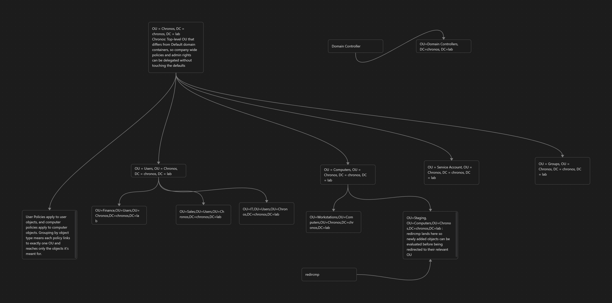

# OU Design: chronos.lab



## Structure

```
chronos.lab
├── Domain Controllers            (built-in; DC01 stays here)
└── Chronos                       (top-level company OU)
    ├── Users
    │   ├── Finance
    │   ├── Sales
    │   └── IT
    ├── Computers
    │   ├── Staging               (redircmp target: new machines land here)
    │   └── Workstations
    ├── Groups
    └── Service Accounts
```

## Distinguished names

| OU                            | Distinguished name                                          |
| ----------------------------- | ----------------------------------------------------------- |
| Chronos                       | `OU=Chronos,DC=chronos,DC=lab`                              |
| Users                         | `OU=Users,OU=Chronos,DC=chronos,DC=lab`                     |
| Finance                       | `OU=Finance,OU=Users,OU=Chronos,DC=chronos,DC=lab`          |
| Sales                         | `OU=Sales,OU=Users,OU=Chronos,DC=chronos,DC=lab`            |
| IT                            | `OU=IT,OU=Users,OU=Chronos,DC=chronos,DC=lab`               |
| Computers                     | `OU=Computers,OU=Chronos,DC=chronos,DC=lab`                 |
| Staging                       | `OU=Staging,OU=Computers,OU=Chronos,DC=chronos,DC=lab`      |
| Workstations                  | `OU=Workstations,OU=Computers,OU=Chronos,DC=chronos,DC=lab` |
| Groups                        | `OU=Groups,OU=Chronos,DC=chronos,DC=lab`                    |
| Service Accounts              | `OU=Service Accounts,OU=Chronos,DC=chronos,DC=lab`          |
| Domain Controllers (built-in) | `OU=Domain Controllers,DC=chronos,DC=lab`                   |

## Reasoning

- **Top-level `Chronos` OU:** separate from the default domain containers, so company-wide policies and admin rights can be delegated without touching the defaults.
- **Separated by object type:** user policies apply to user objects and computer policies apply to computer objects, so each policy links to exactly one OU and reaches only the objects it's meant for.
- **Domain controllers:** DC01 stays in the built-in `Domain Controllers` OU, where the Default Domain Controllers Policy is linked.
- **`redircmp` target: Staging.** redircmp lands here so newly added objects can be evaluated before being redirected to their relevant OU
