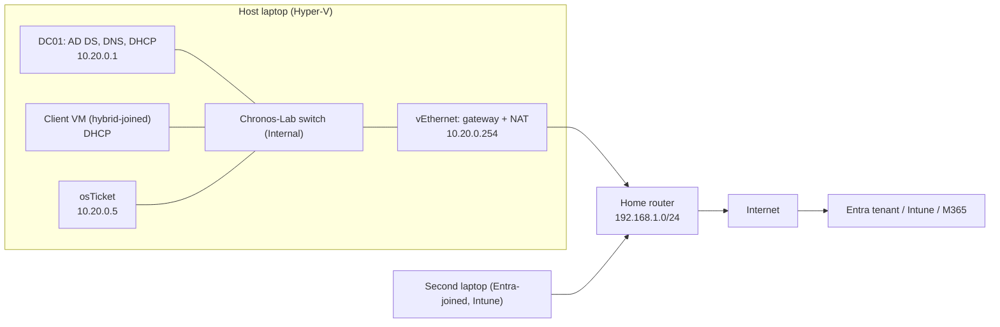

# Lab IP Plan and Topology

## IP plan

| Item | Value | Notes |
| --- | --- | --- |
| Subnet | `10.20.0.0/24` | Kept clear of the home network (`192.168.1.0/24`) |
| Switch | `Chronos-Lab`, Hyper-V Internal | Layer 2, no IP of its own |
| Gateway | `10.20.0.254` | Host laptop's `vEthernet (Chronos-Lab)` adapter, which also does NAT |
| Domain controller | `10.20.0.1` (static) | AD DS, DNS and DHCP |
| Domain | `chronos.lab` | Resolves to the DC (`10.20.0.1`) |
| DNS server for clients | `10.20.0.1` | Must be the DC: AD publishes its SRV records there |
| DHCP scope | `10.20.0.100`–`10.20.0.200` | Served by the DC; static addresses sit outside it |
| osTicket | `10.20.0.5` (static) | Fixed so its web address doesn't change |

## Topology

