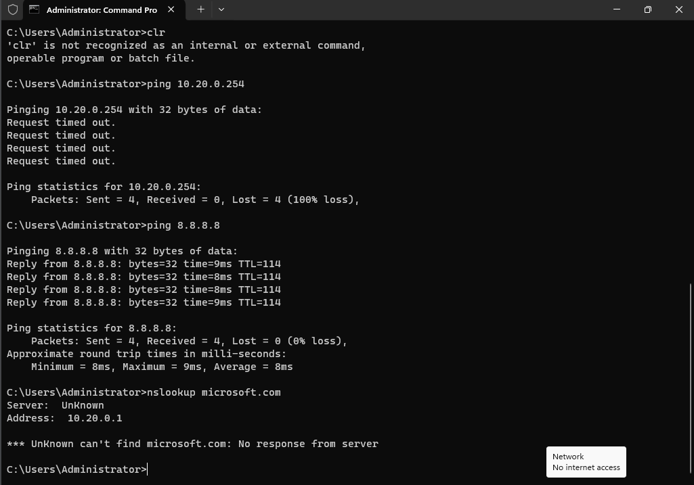
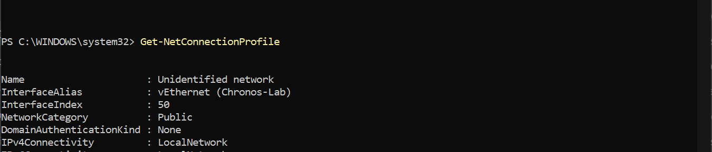
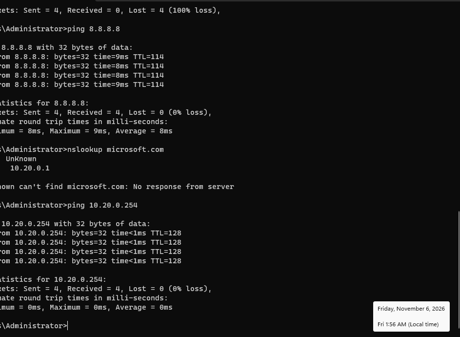

### Default gateway unresponsive to incoming pings

Symptom: pings from DC to gateway were not successful.

Environment:  host Windows 11 on a Latitude 5410 with Hyper-V; guest DC01 running Server 2025 Evaluation; switch `Chronos-Lab` (Internal) with NAT; gateway `10.20.0.254` on the host.

Evidence:  8.8.8.8 replied to the ICMP ping request, the gateway however did not send a ping reply back.

The host vEthernet (Chronos-Lab) adapter was found to have a network category of public, known to be restricted by windows defender firewall and treated as unsafe, dropping all incoming ping requests. 

Root Cause: Traffic addressed to the host is filtered by public firewall profile on vEthernet (Chronos-Lab), while forwarded traffic isn't.

Fix: Initially added a firewall rule permitting traffic from 10.20.0.0/24 on host device, was successful, but too broad. Removed the rule and added a new rule that accepted inbound pings from 10.20.0.0/24 on vEthernet (Chronos-Lab). See [RB-003](../Runbooks/RB-003-Setting_up_firewall_rule_for_gateway.md). Verified: ping from DC01 to `10.20.0.254` now succeeds.

Prevention: Future profiles should either be vetted and added as a private profile, or include the firewall rule as the first step before further configuration of the network.
