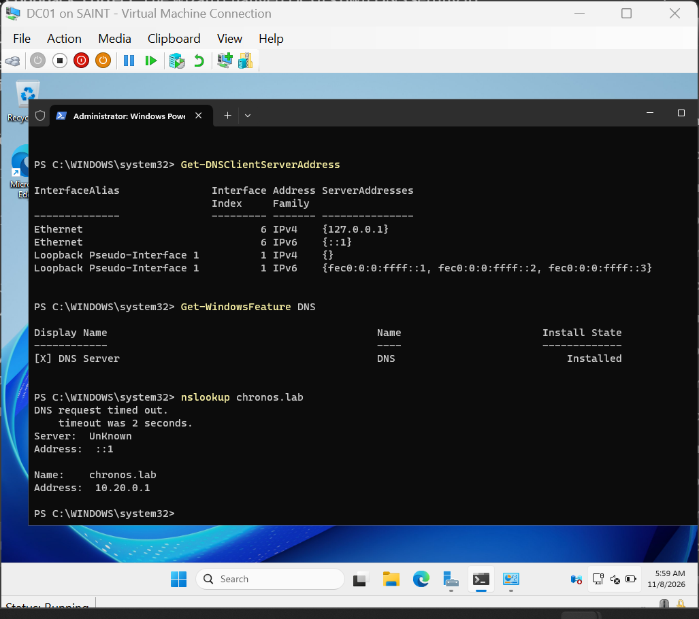
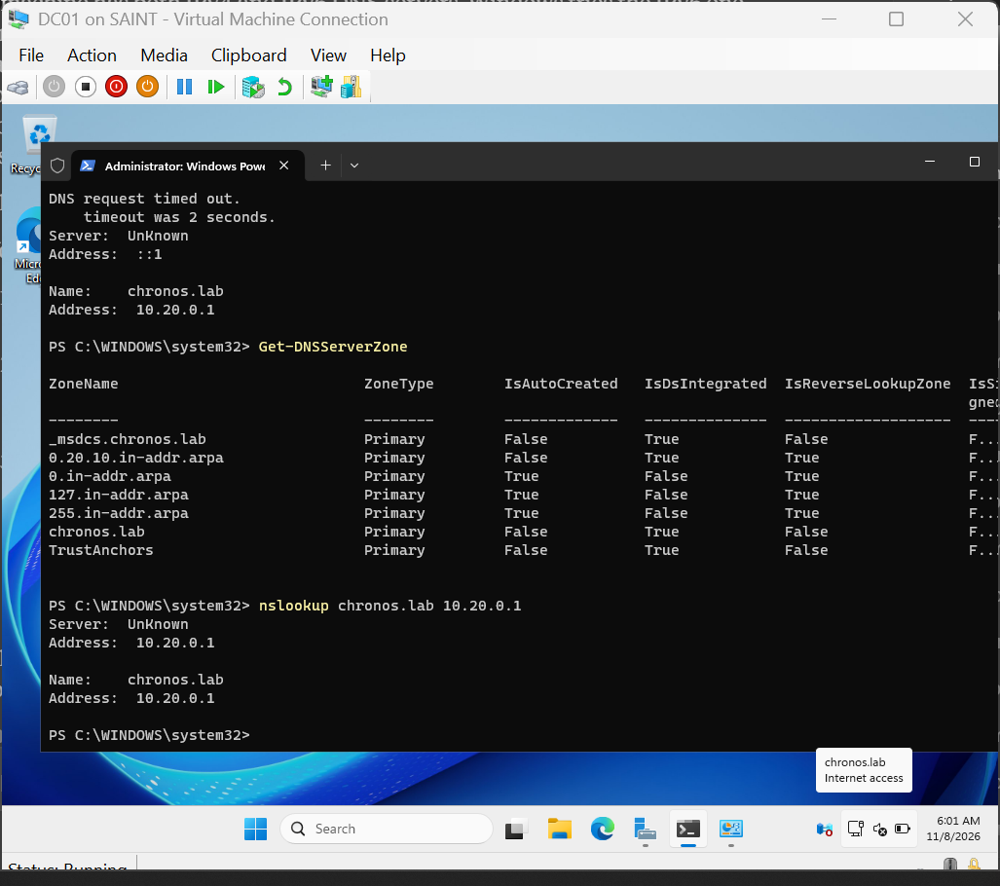
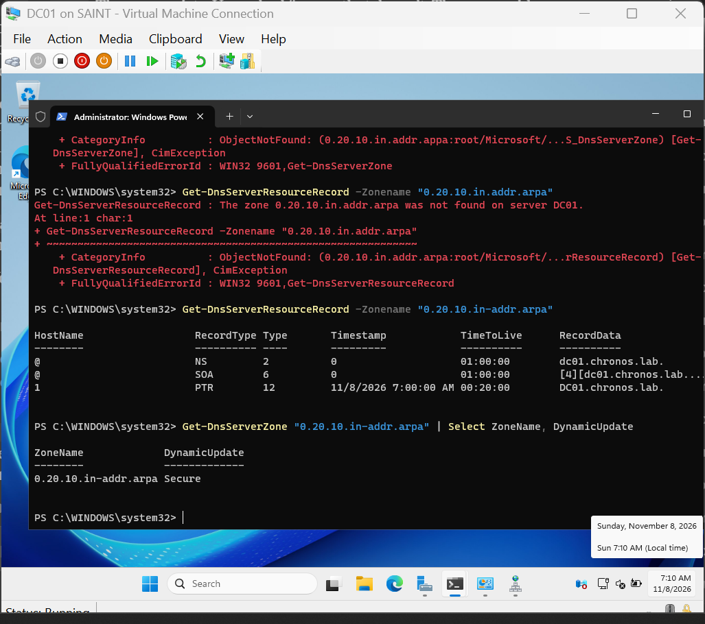
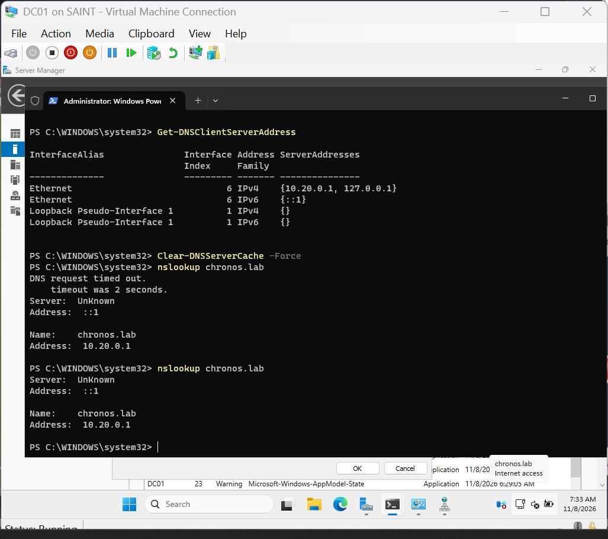
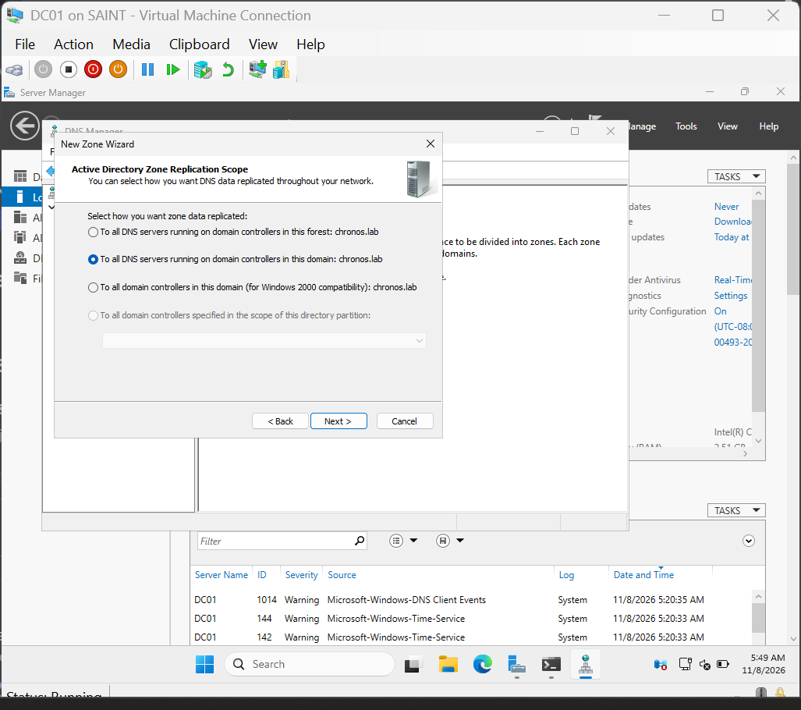
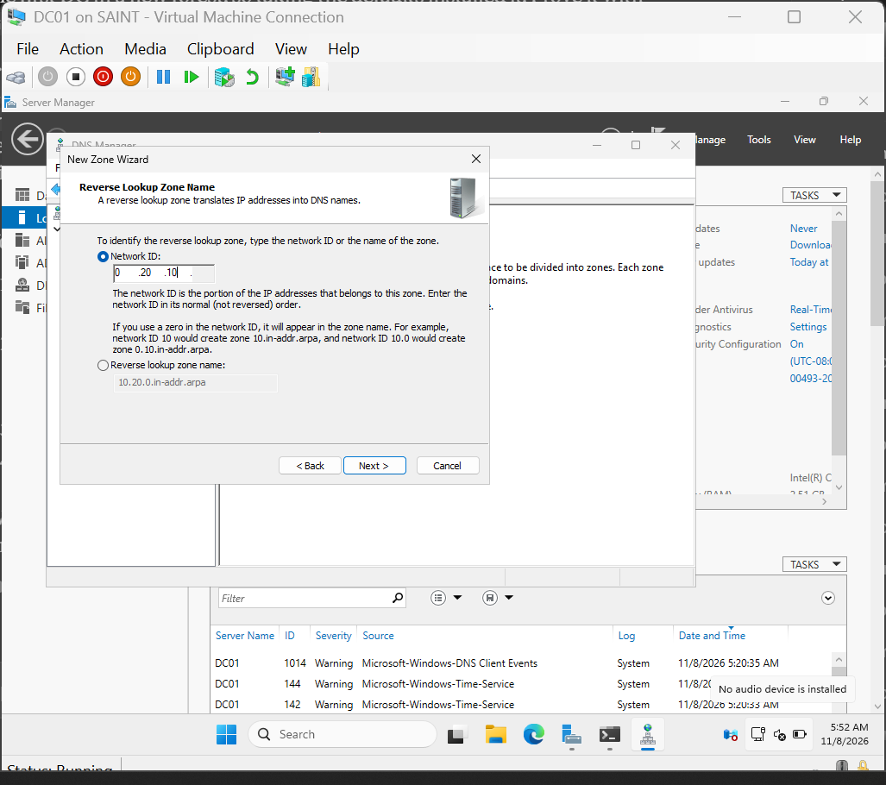
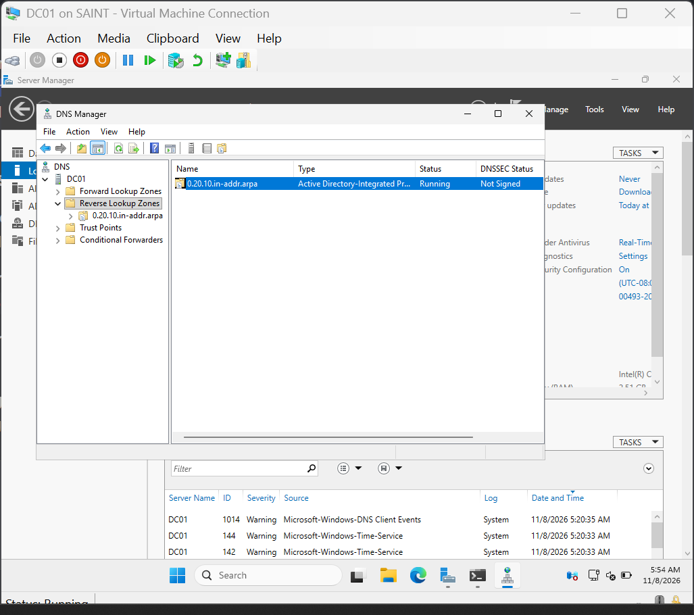
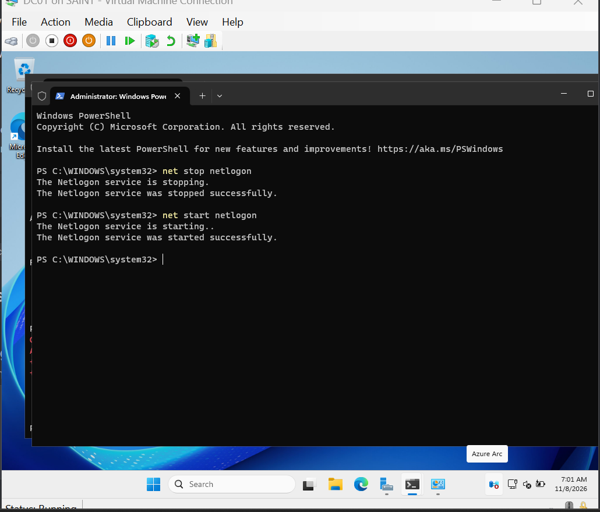
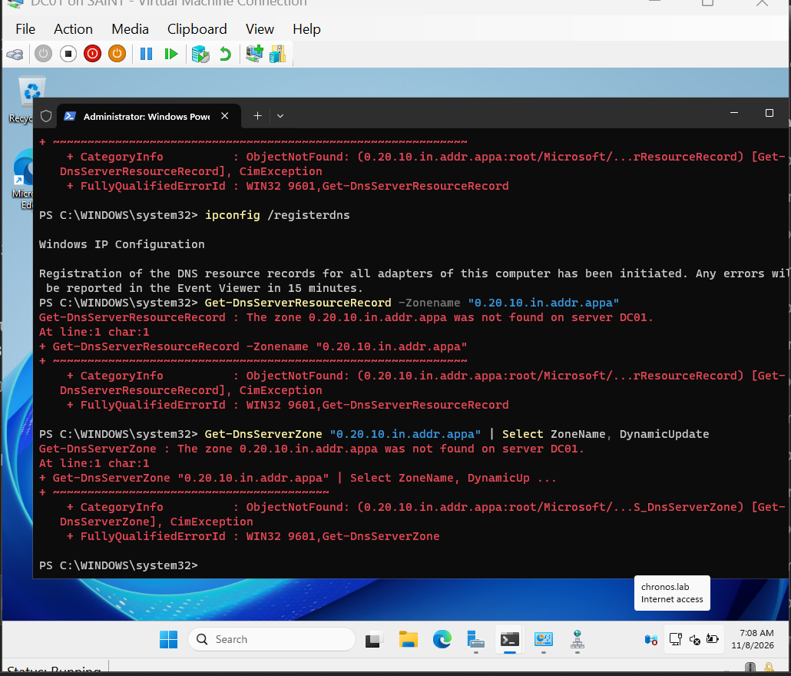

### Every nslookup on DC01 returned a Server: Unknown Response

Symptom: nslookup on DC01 returned a server: unknown response and a 2 second timeout, with subsequent nslookup requests on DC01 just returning the server: unknown response.

Environment: host Windows 11 on a Latitude 5410 with Hyper-V; guest DC01 running Server 2025 Evaluation; switch `Chronos-Lab` (Internal) with NAT; gateway `10.20.0.254` on the host.

Root Cause: There was no reverse zone for 10.20.0.0/24, so there was no PTR record. That was fixed with an AD-integrated reverse lookup zone along with an ipconfig /registerdns. nslookup queries the IPv6 DNS server(::1), the address's name is looked up on the internet, which takes longer than the time limit until the "no such name" answer is cached.

Evidence: The IPv4 query (nslookup chronos 10.20.0.1) has no timeout. The PTR record has a timestamp, which means it was dynamically registered. The timeout response only comes after the DNS cache is flushed.

Fix: Tried to use netlogon restart(wrong service: uses locator records, not PTR records), in.addr.appa was continuously used to verify the PTR record instead of in-addr.arpa, leading to false troubleshooting, and a false theory regarding ::1 IPv6 address causing a collision if it wasn't removed.  change of the address name to in-addr.arpa and lookup of the PTR confirmed the fix, although the quirk of server: unknown is still present due to the presence of the harmless ::1 IPv6 address whenever DC01 is queried.

