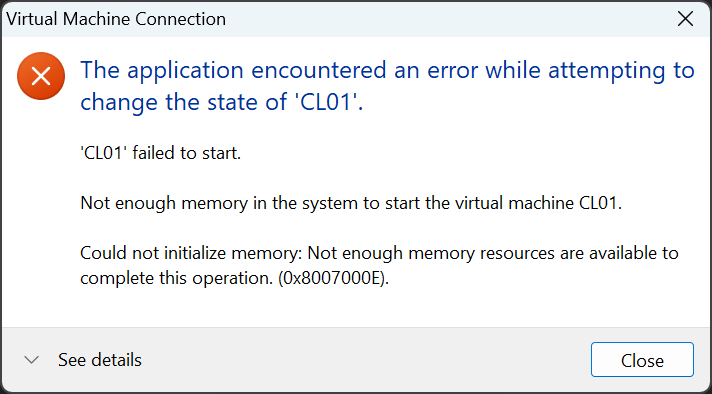

# KB-003: VM fails to start with 0x8007000E

## Symptom
A VM fails to start with error `0x8007000E`.

## Environment
- Host: Windows 11 on a Latitude 5410 with Hyper-V, 16 GB RAM; switch `Chronos-Lab` (Internal) with NAT; gateway `10.20.0.254` on the host.
- DC01: Server 2025 Evaluation.
- CL01: Windows 11 Enterprise Evaluation (the VM that failed to start).

## Evidence
A dialog box stating that the VM could not be started because sufficient memory couldn't be allocated.

## Root cause
Insufficient RAM on the host to start the Hyper-V VM instance.

## Fix
Opened Task Manager, closed RAM-heavy processes, set the DC01 VM to 2 GB of fixed RAM, and gave CL01 2 GB of dynamic memory that can grow to 4 GB.
