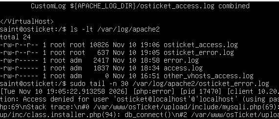

# KB-004: osTicket returns HTTP 500 after submitting the setup page

## Symptom
A minimal-detail "page isn't working" message with an HTTP Error 500 after submitting details on the osTicket setup page.

## Environment
- Host: Windows 11 on a Latitude 5410 with Hyper-V; switch `Chronos-Lab` (Internal) with NAT; gateway `10.20.0.254` on the host.
- DC01: Server 2025 Evaluation, DNS server for the osTicket VM.
- OSTICKET01 (`10.20.0.5`): Ubuntu Server 24.04.5 running the LAMP stack: Apache, MariaDB, PHP 8.4, osTicket v1.18.4.

## Investigation
1. Checked Apache's global error log for errors Apache had surfaced:
   ```bash
   sudo tail -n 30 /var/log/apache2/error.log
   ```
2. Checked the access logs to see whether the request had reached Apache at all:
   ```bash
   sudo tail -n 20 /var/log/apache2/*access*.log
   ```
3. Reading my own virtual host configuration showed that the site writes to its own log, `/var/log/apache2/osticket_error.log`, not the global one:
   ```bash
   sudo cat /var/log/apache2/osticket_error.log
   ```
   This log held the evidence for the error.

## Evidence
`/var/log/apache2/osticket_error.log`, `Tue Nov 10 19:05:22.913258 2026`, thrown in `/var/www/osTicket/upload/include/mysqli.php` on line 69:

```
PHP Fatal error:  Uncaught mysqli_sql_exception: Access denied for user 'osticket@localhost'@'localhost' (using password: YES)
```



## Root cause
I entered `osticket@localhost` rather than `osticket` in the database username field on the osTicket setup page. MariaDB treated the whole string as the username, then appended its own `@'localhost'` host part.

## Fix
Re-submitted the setup page with `osticket` in the username field.
