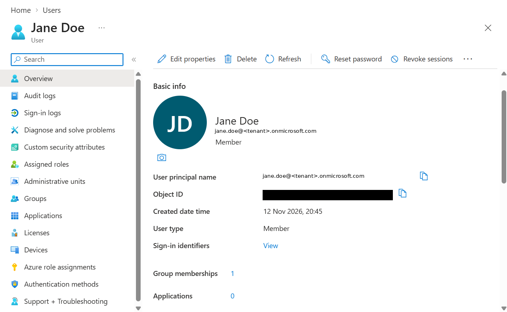
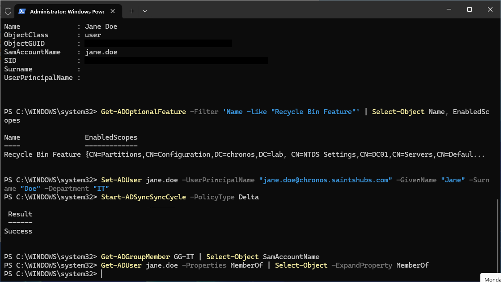
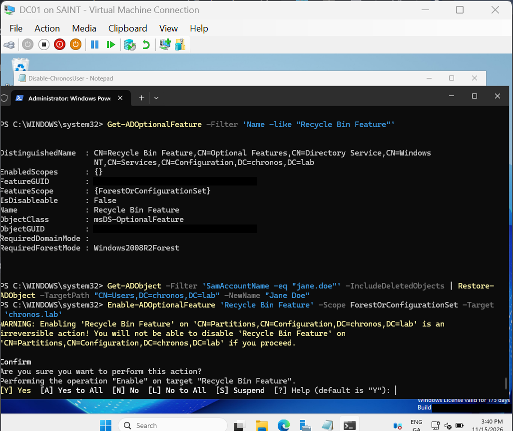
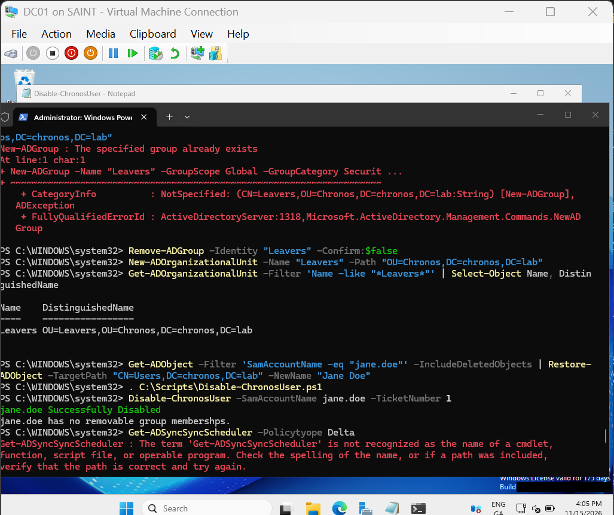
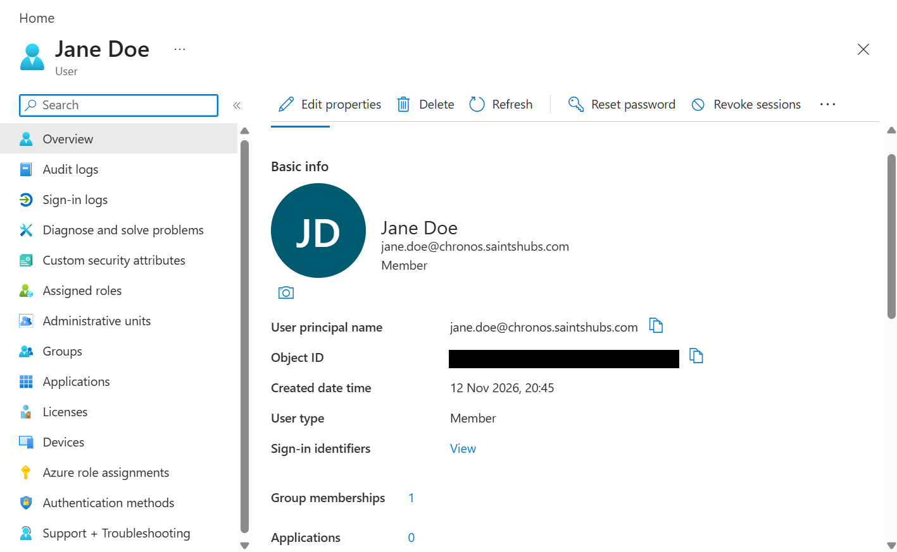

Troubleshooting AD User showing Entra Default Domain

Symptom: A UPN showing the default domain for Entra on the Entra Admin Center for a user.

Environment

* Host: Windows 11 on a Latitude 5410 with Hyper-V; switch `Chronos-Lab` (Internal) with NAT; gateway `10.20.0.254` on the host.
* DC01: Server 2025 Evaluation, Administrator Powershell Instance
* Entra Admin Center

Investigation

I initially came across a no group memberships output when running the leaver script for the user but didn't think much of it.

I successfully disabled the user and another user.

Spotted during a post-change review of the Entra user list

I ran a Get-ADUser jane.doe -Properties UserPrincipalName cmdlet on the DC01 administrator powershell instance

I confirmed the UPN was empty on AD, but also the Surname and Given Name

I confirmed the AD recycle bin feature was turned on

Then i remembered i had deleted the user before turning the AD recycle bin feature on, thereby causing a partial or tombstone reanimation of the user's properties rather than a full restore.

Evidence

The Get-ADUser jane.doe -Properties UserPrincipalName cmdlet returned an empty UPN, Surname and Given Name, and Entra used its default domain for the UPN.

 Get-ADOptionalFeature -Filter 'Name -like "Recycle Bin Feature"' | Select-Object Name, EnabledScopes cmdlet showing recycle bin state with {CN=Partitions,CN=Configuration,DC=chronos,DC=lab, CN=NTDS Settings,CN=DC01,CN=Servers, and other enabled scopes}

Root Cause

I only enabled Recycle bin feature after i had already  previously deleted the user, leading to tombstone reanimation for the user's properties.

Fix

ran the following cmdlets:

Set-ADUser jane.doe -UserPrincipalName "jane.doe@chronos.saintshubs.com" -GivenName "Jane" -Surname "Doe" -Department "IT"

Start-ADSyncSyncCycle -PolicyType Delta

UPN is back to AD domain on Entra Admin Centre, original object kept: the creation date is still 12 Nov.

