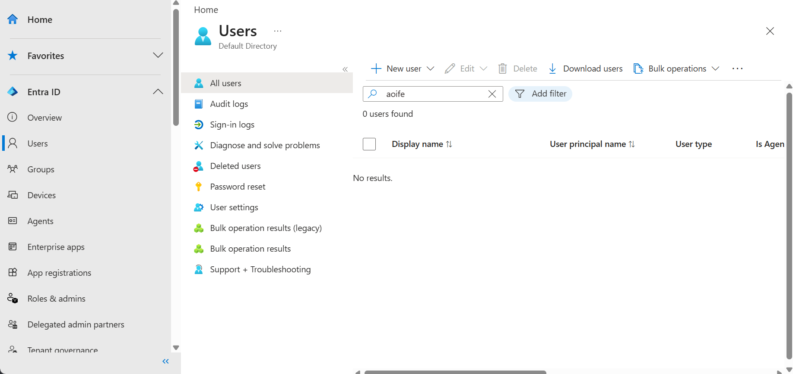
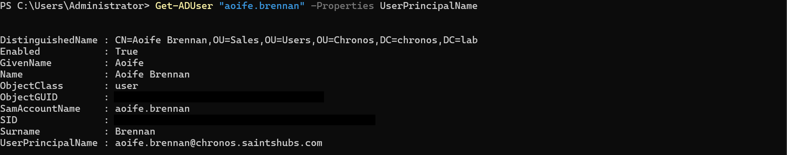
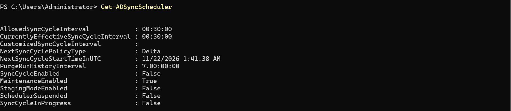
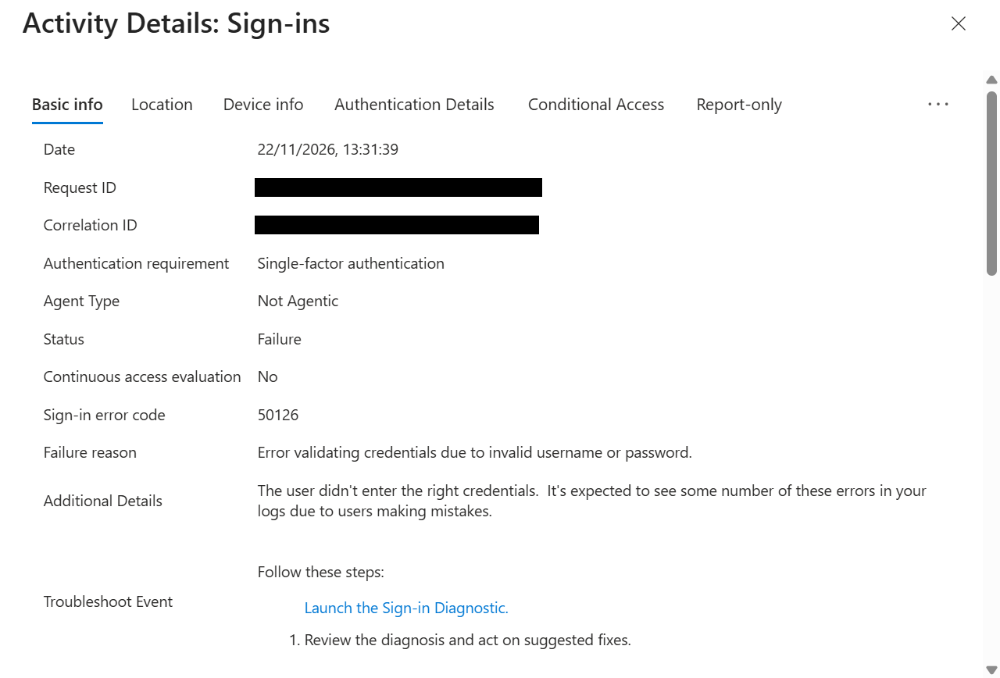
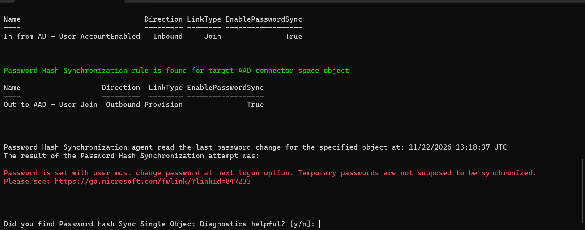
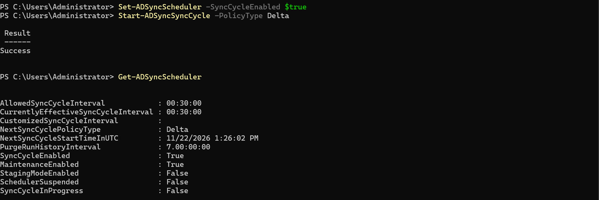
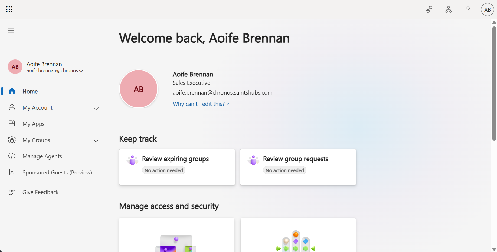

Symptom: New user exists in AD and can sign in to a domain PC; cloud sign-in returns 'username may be incorrect'. After the fix, sign-in fails with error 50126.

Environment: Local directory hosted on DC01 Windows server 2025 on hyper-v, Microsoft Entra Admin Center, Microsoft Entra Connect server on DC01 VM, Microsoft Web Account instance on private window, domain-joined CL01 computer on Windows 11 Enterprise Evaluation edition, Windows Powershell Administrator instance on DC01, osTicket VM on LAMP stack, local web server browsing osTicket on CL01 VM.

Cause: The root cause was a disabled sync scheduler (cause of disablement: undetermined), the secondary cause was the inability to sync temporary passwords to Entra.

Evidence: Verification on Entra proved the user did not exist, the Get-ADUser cmdlet on the user's identity proved the user existed in the local directory, the Get-ADSyncScheduler cmdlet highlighted a disabled sync scheduler with a next sync schedule time set at 22/11/2026 1:41:38am from the current time of 22/11/2026 12:51pm. Sign-in logs for the user on Entra admin center produced an error code 50126. The launched troubleshoot password hash synchronisation feature revealed temporary passwords aren't supposed to be synced, leaving forced and automated sync schedules unable to update user password from previous unknown random value initially generated. 

Investigation: Initial diagnosis was that the user's local directory SamAccountName had been changed and synced to Entra, the next diagnosis waa that the account exist on prem and has been successfully created, it hasn't just reached the sync cycle for entra, hence providing no details for entra to verify the new user against.

Fix:  The fix was to enable the sync cycle through the Set-ADSyncScheduler -SyncCycleEnabled $true cmdlet on DC01, then force the schedule through the Start-ADSyncSyncCycle -PolicyType Delta cmdlet. The fix for the secondary issue was to have the user login on the local domain system and change the password locally, then make the sync to Entra. 

Prevention: A scheduled script that checks the status of the AD sync scheduler hourly and checks `SyncCycleEnabled -eq $false` **or** `NextSyncCycleStartTimeInUTC` in the past, then reports the output to both a schedulerstatus.csv and windows application event log with a warning status. for synced users, don't combine an admin reset with `ChangePasswordAtLogon`; have the user change the password on-prem first.

