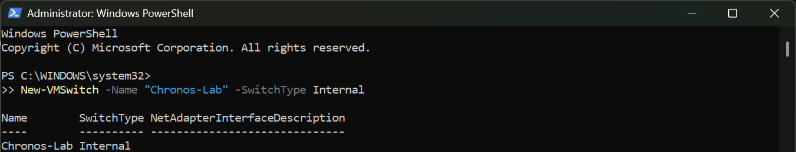

### Creating a lab network

New-VMSwitch -Name "Chronos-Lab" -SwitchType Internal

New-NetIPAddress -InterfaceAlias "vEthernet (Chronos-Lab)" -IPAddress 10.20.0.254 -PrefixLength 24

New-NetNat -Name "NATNetwork" -InternalIPInterfaceAddressPrefix 10.20.0.0/24

PS C:\WINDOWS\system32> Get-NetNat

Name                             : NATNetwork
ExternalIPInterfaceAddressPrefix :
InternalIPInterfaceAddressPrefix : 10.20.0.0/24
IcmpQueryTimeout                 : 30
TcpEstablishedConnectionTimeout  : 1800
TcpTransientConnectionTimeout    : 120
TcpFilteringBehavior             : AddressDependentFiltering
UdpFilteringBehavior             : AddressDependentFiltering
UdpIdleSessionTimeout            : 120
UdpInboundRefresh                : False
Store                            : Local
Active                           : True

PS C:\WINDOWS\system32> Get-NetIPAddress -InterfaceAlias "vEthernet (Chronos-Lab)" -AddressFamily IPv4

IPAddress         : 10.20.0.254
InterfaceIndex    : 50
InterfaceAlias    : vEthernet (Chronos-Lab)
AddressFamily     : IPv4
Type              : Unicast
PrefixLength      : 24
PrefixOrigin      : Manual
SuffixOrigin      : Manual
AddressState      : Preferred
ValidLifetime     : Infinite ([TimeSpan]::MaxValue)
PreferredLifetime : Infinite ([TimeSpan]::MaxValue)
SkipAsSource      : False
PolicyStore       : ActiveStore
