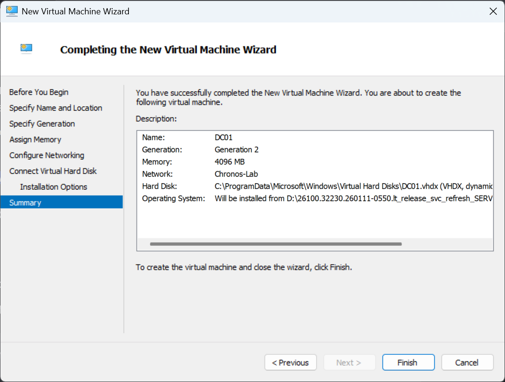
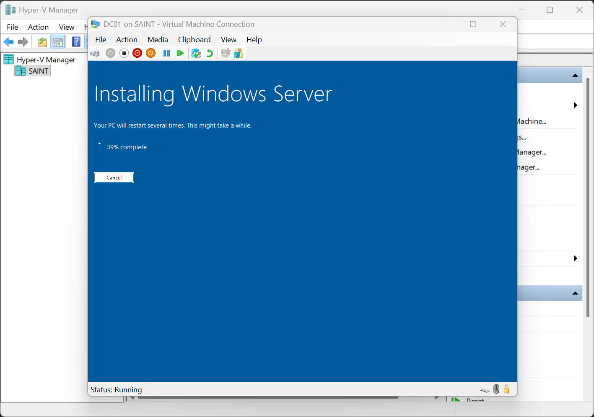
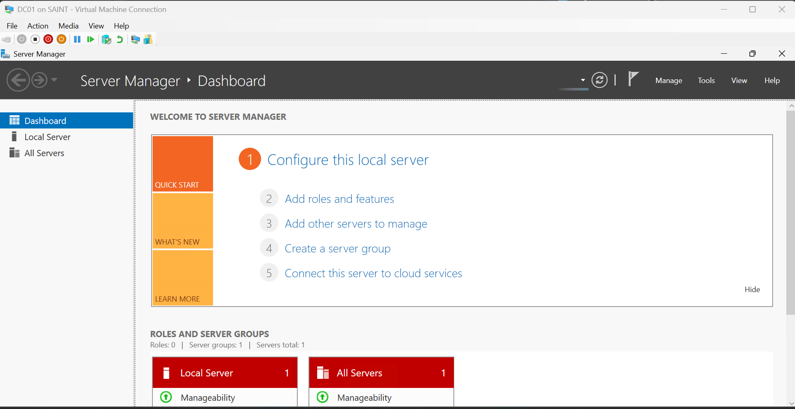
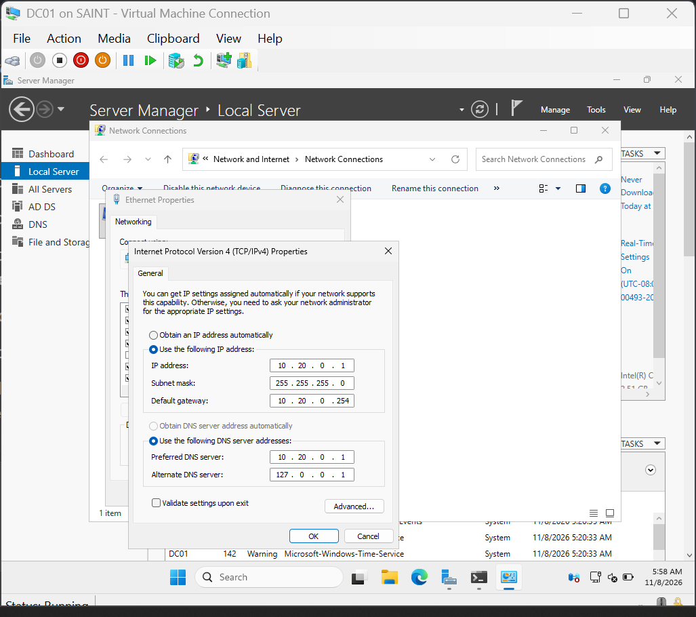
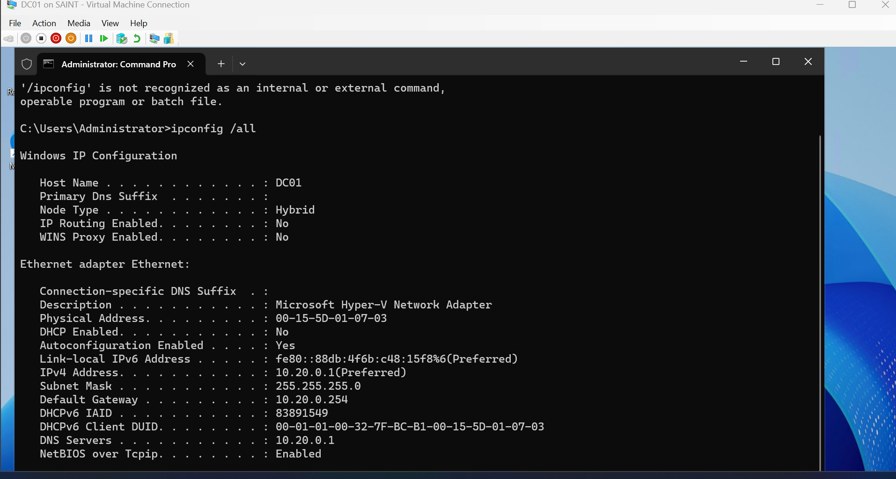
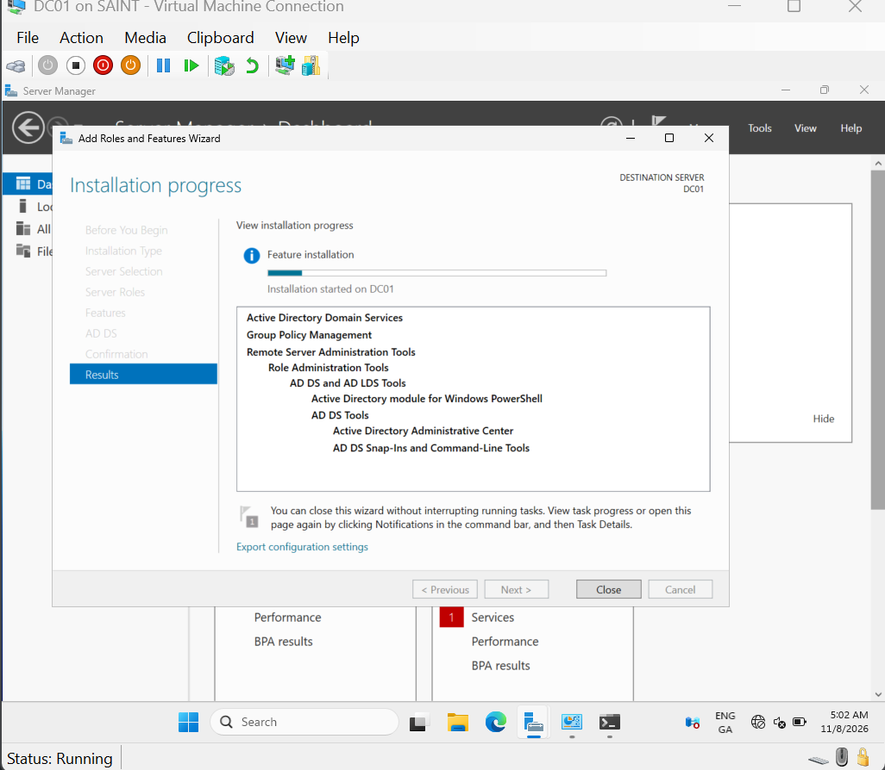
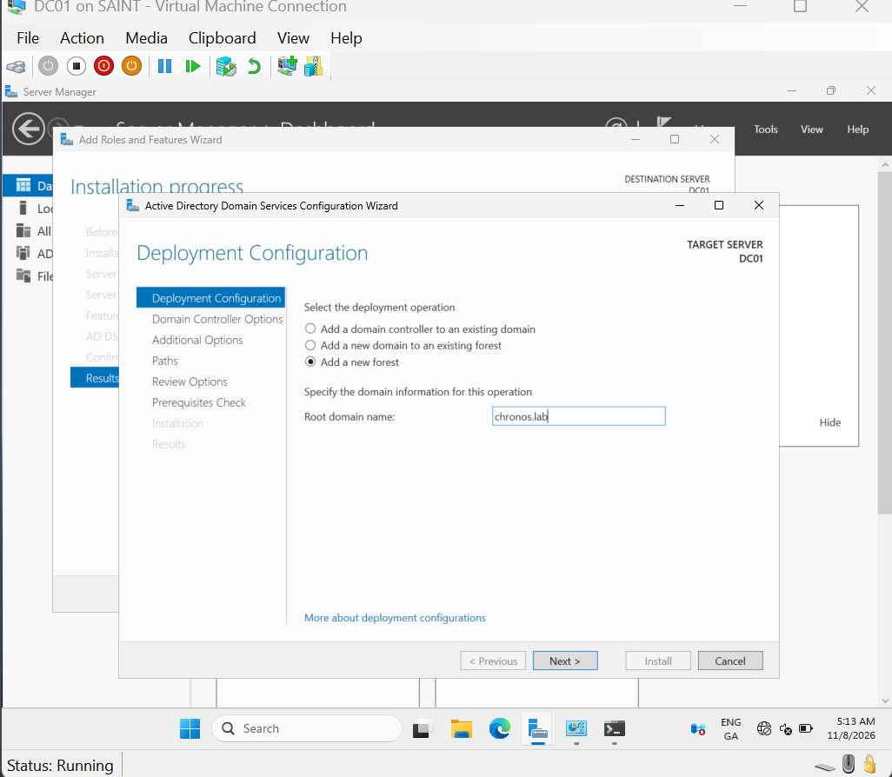
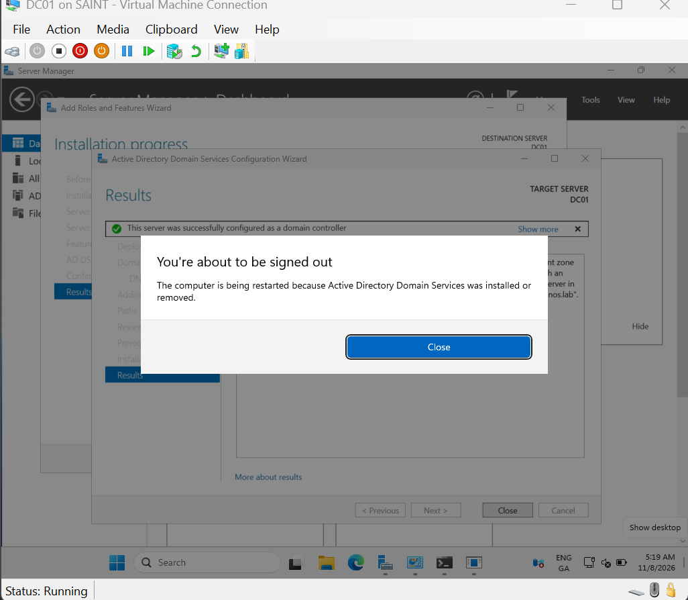
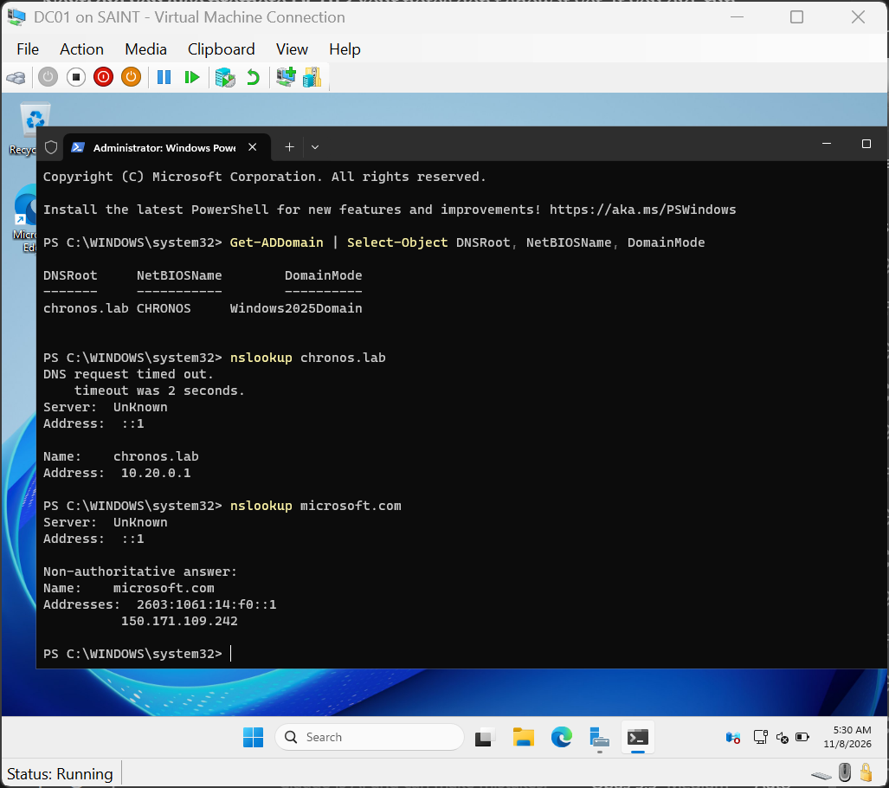

### Setting up the domain controller (DC01)

#### 1. Create the VM

#### 2. Install Windows Server

Had to press a button immediately after to avoid operating system not found error

#### 3. Name, static IP and DNS

changed the computer name and IP settings to the specified design in the lab topology and IP Plan

I set up the DC as the DNS Active Directory stores the records clients use to find domain name in the DC DNS, and the DC registers them there itself.

#### 4. Install AD DS and create the chronos.lab forest

Navigated to Dashboard

Went through the installation setup

Created an AD DS

Promoted DC01 to Domain controller

set forest name to chronos.lab

server restarted

Confirmed the presence through Get-ADDomain | Select-Object DNSRoot, NetBIOSName, DomainMode command

