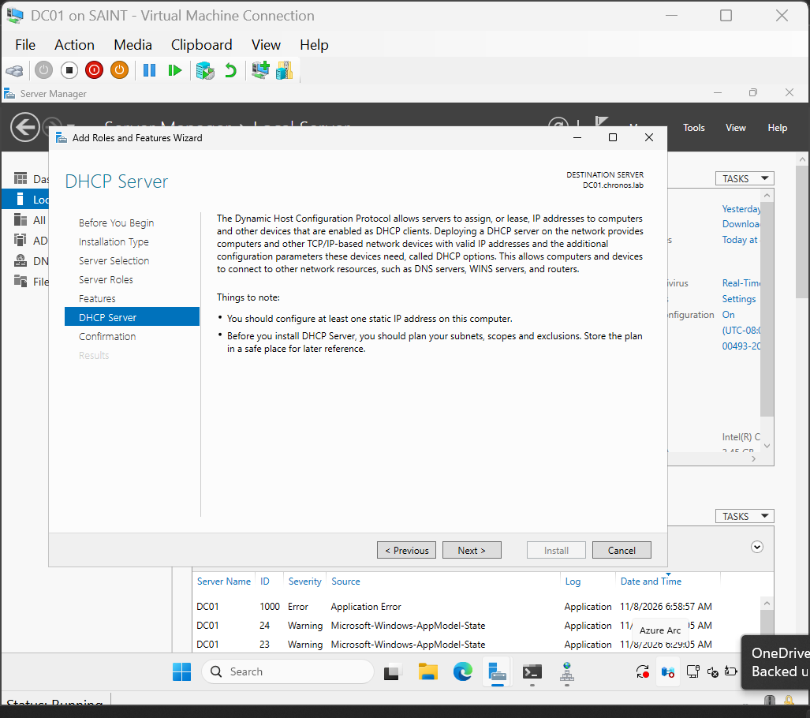
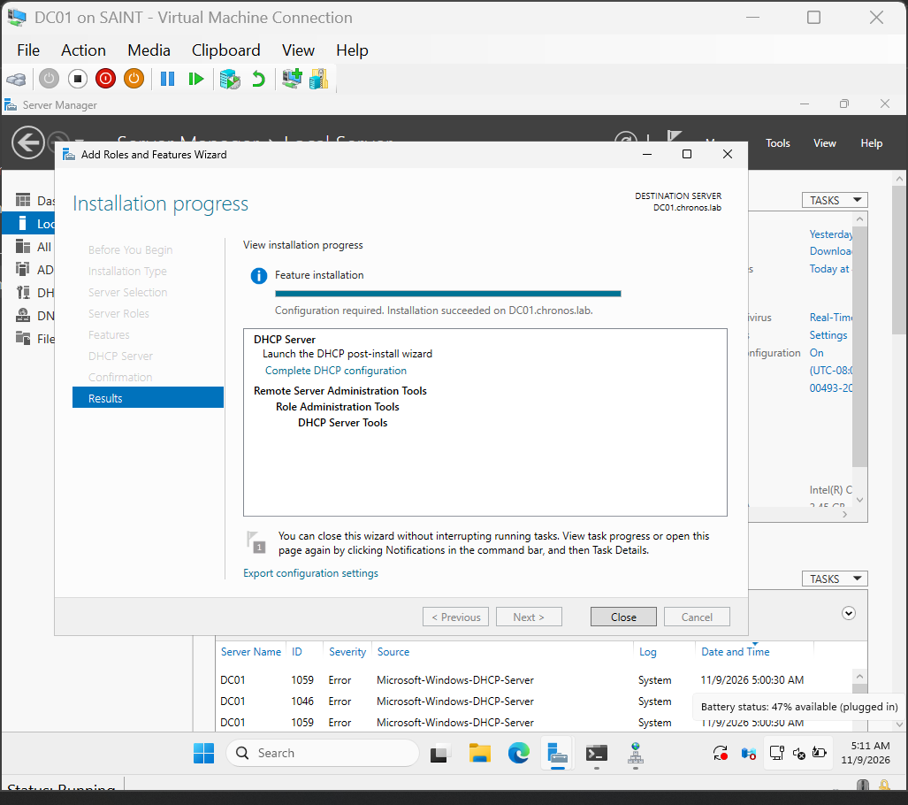
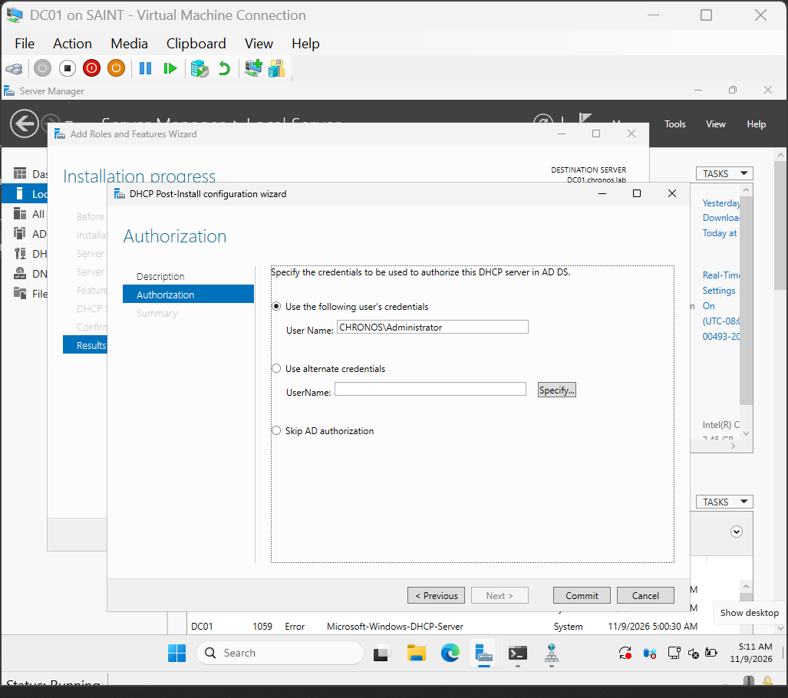
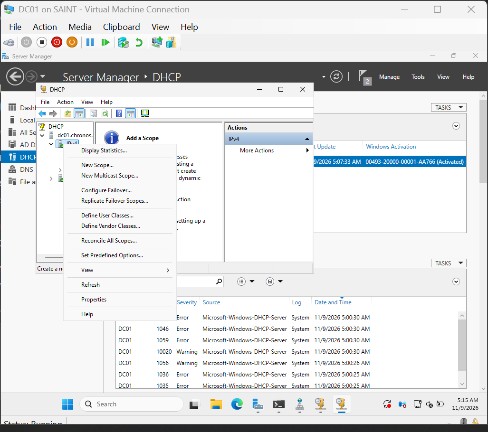
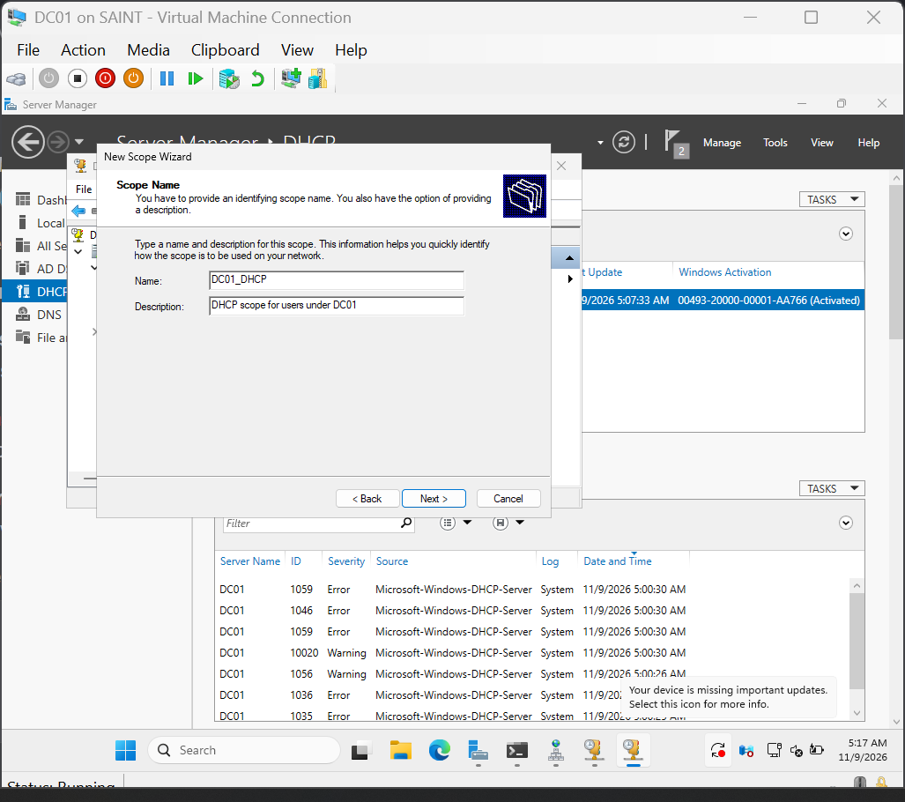
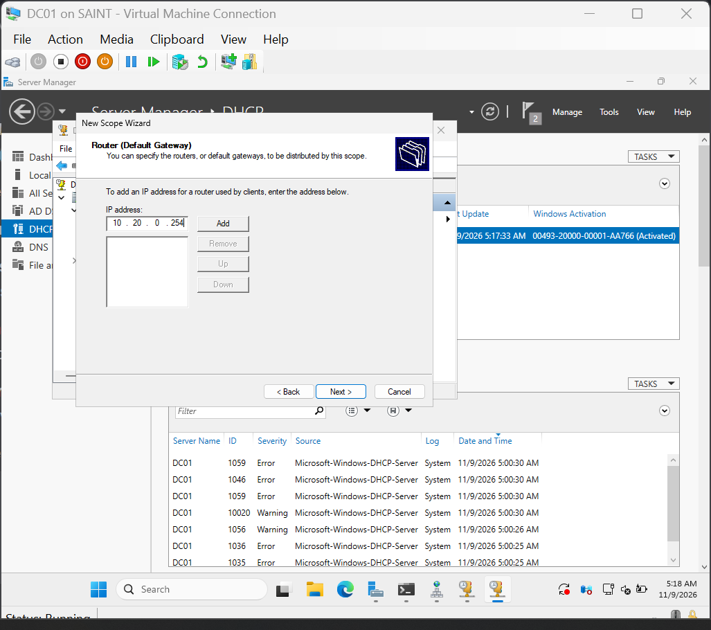
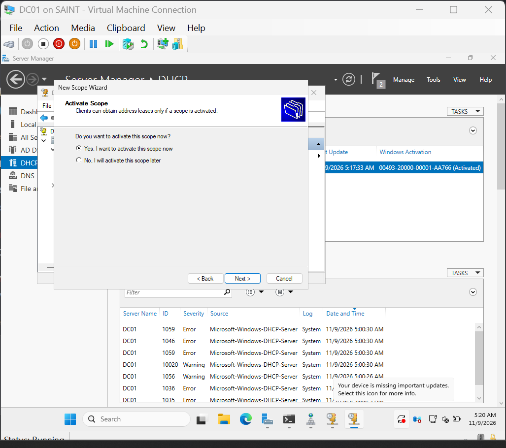
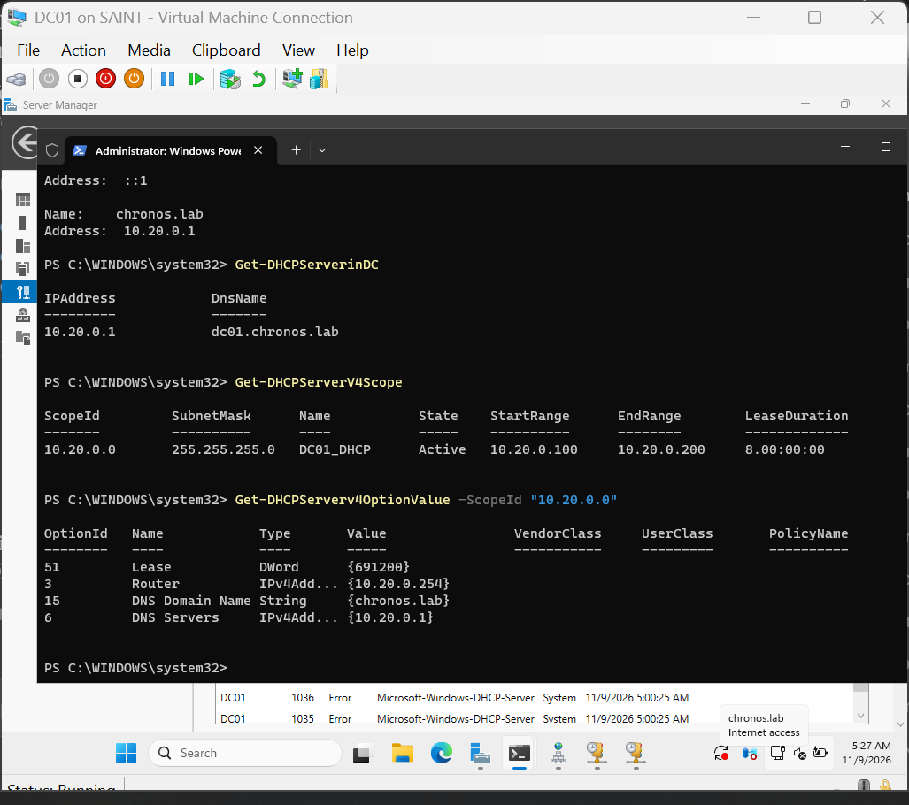

### Setting up DHCP on DC01

Navigated to server manager

Chose to add roles and features in the manage tab in server manager

went through the installation guide

added DHCP server

After install, I authorized the DHCP server in AD

I navigated to the DHCP management console to create a new IPv4 scope.

During the DHCP setup, i added the same DNS address 3 times, potentially causing clients to resolve the same address thrice, wasting compute and time, i solved this by navigating to the DHCP management console, and the scope options under IPv4, then i navigated to the 006 - DNS servers section and removed the two redundant addresses, i then confirmed everything was in order through Get commands in powershell.

