# RB-006: Setting up osTicket's LAMP stack and integrating it into existing architecture

## 1. Building the VM

Downloaded ubuntu 24.04 LTS server ISO from official ubuntu page

Created a new VM on hyper-v

Set the Secure boot template that's microsoft windows by default on generation 2 vms on hyper-v to windows uefi certificate authority, since the default by generation 2 vms fails to load linux boot loaders

Started the VM

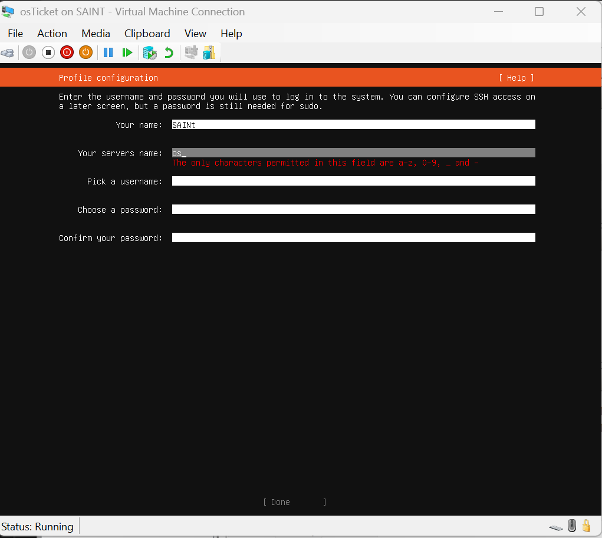

Ran into issues such as screen freeze and refusal of input when installing ubuntu

I identified a possible problem as the memory

Set the memory to 4096 mb and retried

it successfully worked

I realised i had not set the network manually

deleted the VM from hyper-v and tried to reinstall

kept coming up with failure to install on the hard disk path

i identified a potential problem as the presence of a preexisting disk which stopped the creation of a new one

i deleted the existing hard disk, the VM successfully installed after that, then i set the manual IPv4 during the ubuntu installation

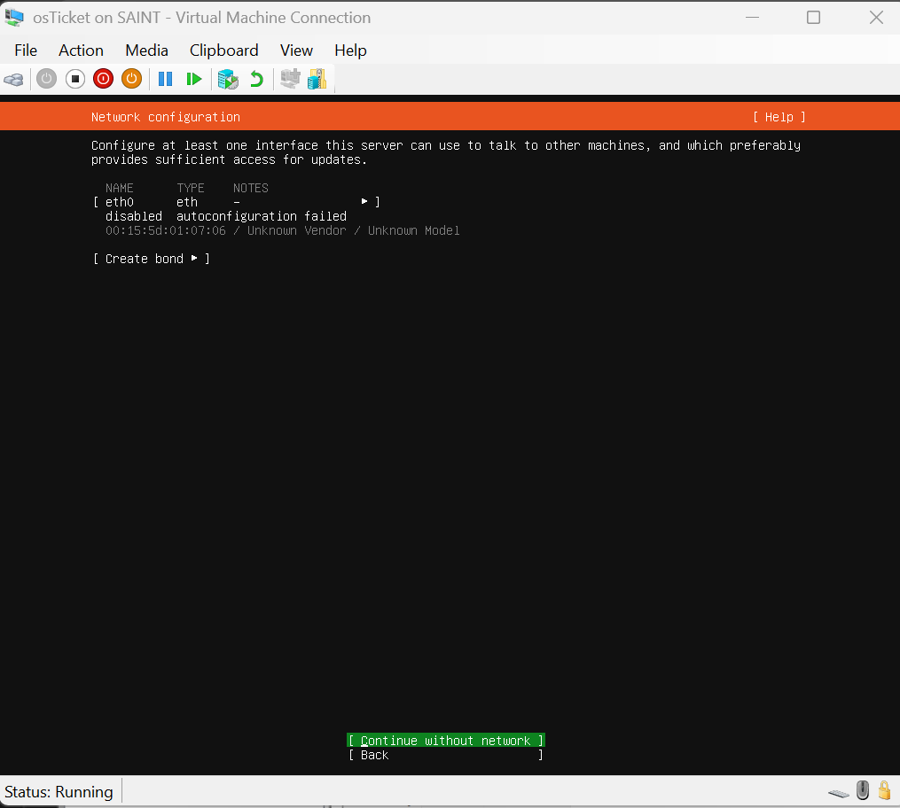

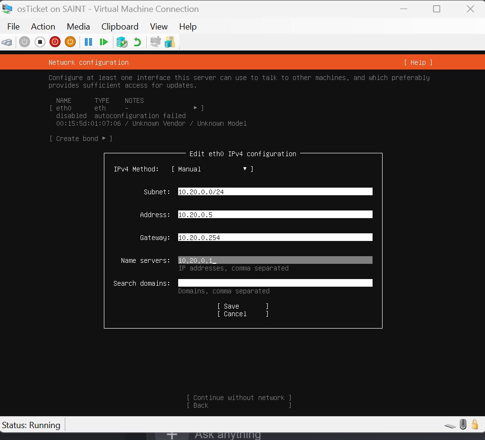

I confirmed access to the ubuntu server then stopped it

## 2. Registering DNS records and reaching the server

I ran nslookup on the domain of the osTicket on CL01 before registering its records on DC01, found a non-existent domain response, i registered the domain through the `Add-DnsServerResourceRecordA` cmdlet paired with the `-CreatePtr` parameter to automatically create a Ptr record when creating the A record for the osTicket domain, i retried the nslookup command on CL01 to osTicket's domain, i got a successful resolution, with the name as osTicket's domain name, and the address as the address of osTicket, then on my personal laptop, i tried to SSH into osTicket, it failed because my ISP's DNS server has no reference to osticket.chronos.lab domain, so i used a cmdlet in powershell (`Add-DnsClientNrptRule -Namespace ".chronos.lab" -NameServers "10.20.0.1"`) that forwards any chronos.lab requests to my DC01 DNS, after which i gained access to the osTicket on my personal laptop through powershell, ran a `resolvectl status` command to verify its dns configuration, and a ping command to the domain controller's domain to verify network reachability.

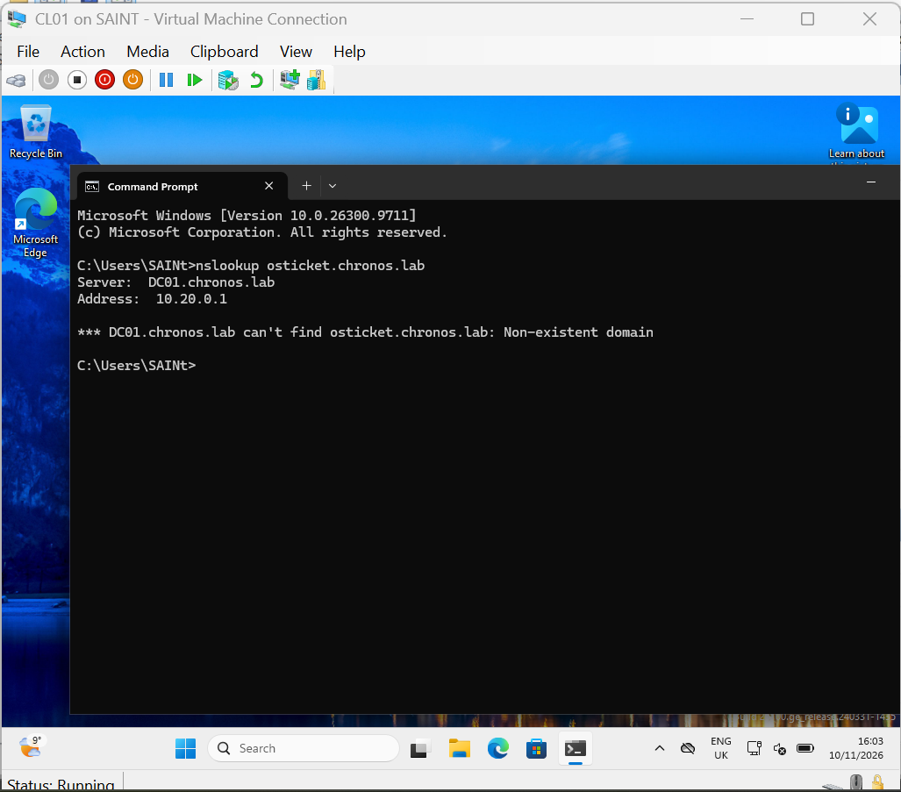

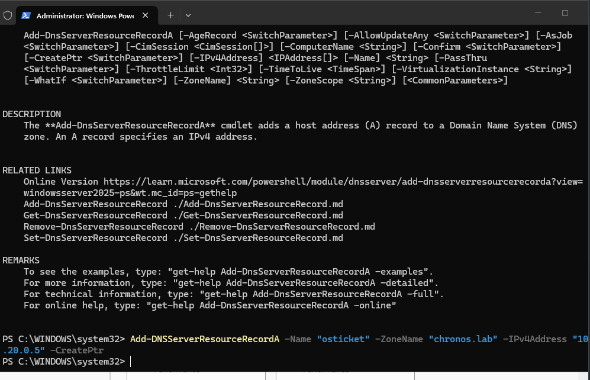

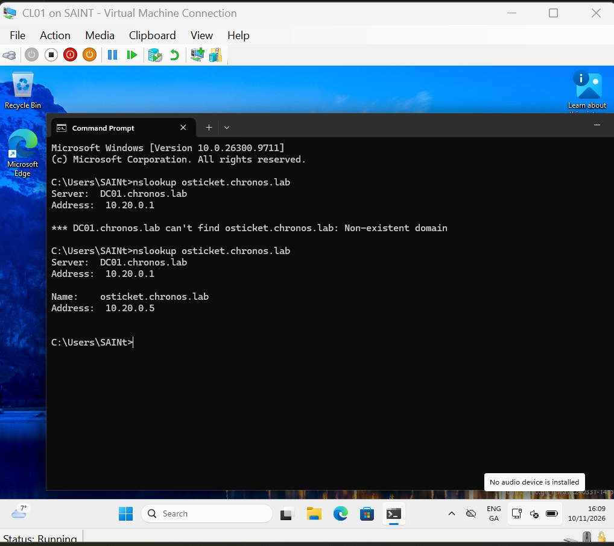

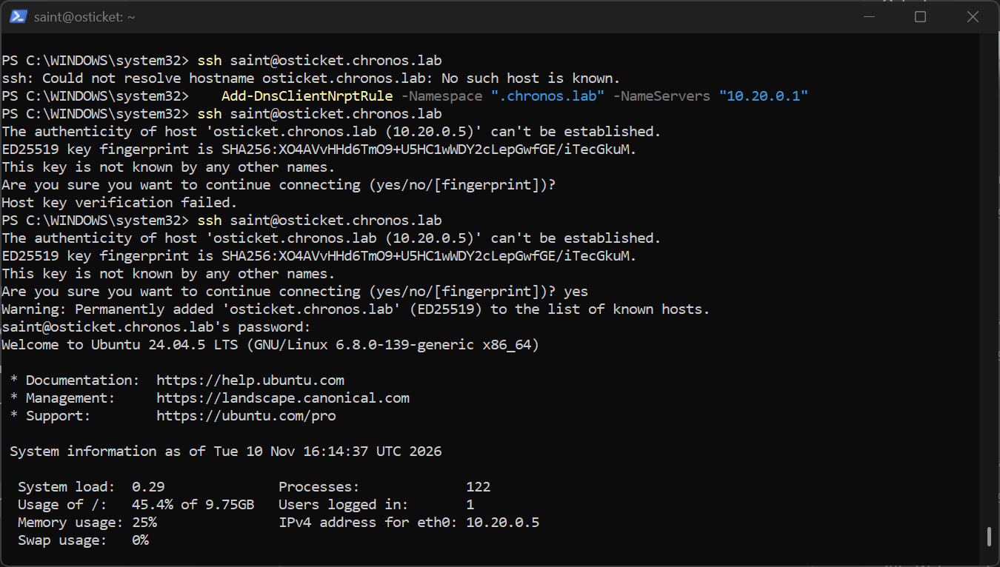

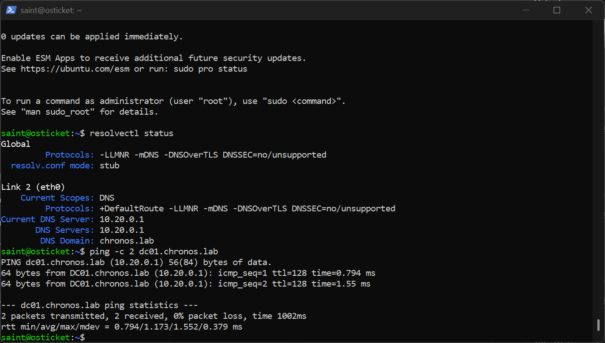

## 3. Installing the LAMP stack

I chose to install Apache, then MariaDB, then PHP, apache first because it's the foundation of web environment, it needs to be installed first so php can automatically detect apache and configure the necessary modules during its install. MariaDB is completely independent of the other two, but it allows for convenience in getting the db server up and running and securely configured before introducing the scripting language, php last because it acts as the bridge between mariadb and apache, installing it last gives you enough foundations to already have the other two set up.

On the ubuntu server, i updated and installed apache2, i first confirmed the firewall was inactive through `sudo ufw status`, then i verified it through navigating to http://osticket.chronos.lab, where i was greeted by an apache it works page.  and to prove apache was listening, i ran the `sudo ss -tlnp | grep :80` command on the ubuntu server.

Then i proceeded to install and secure Mariadb, after which i created a database named osticket, with an osticket@localhost user, which i granted privileges to the osticket.* database only. An example of the command, which has the password excluded for security reasons, is shown below:

```sql
CREATE DATABASE osticket;
CREATE USER osticket@localhost IDENTIFIED BY '<redacted>';
GRANT ALL PRIVILEGES ON osticket.* TO osticket@localhost;
FLUSH PRIVILEGES;
EXIT;
```

After which i verified by logging in as the just created user through the `mariadb -u osticket -p` command, and a `SHOW DATABASES;`, which proved the successful creation and privilege assignment of the database. on CL01, i verified the mariadb server could not be reached through the 10.20.0.5:3306 address. and used the `sudo ss -tlnp | grep 3306` command which confirmed the database was listening on `127.0.0.1:3306` in the local address column, proving it was bound to loopback only.

I then configured PHP and it's required extensions by osTicket, then to prove php works, i created an info.php subpage and navigated to http://osticket.chronos.lab/info.php, where i was met with the configuration information for php, i deleted the subpage after verification through `sudo rm` because it exposed my whole configuration to anyone that loaded it. for the php i used a third party repository which installed version 8.4 and its extensions. I verified the security state of the third party source i used through `apt policy php8.4` and `ls /etc/apt/sources.list.d/`.

## 4. Installing osTicket

I downloaded the osTicket application through the `wget https://github.com/osTicket/osTicket/releases/download/v1.18.4/osTicket-v1.18.4.zip` command, initially using the unzip command to decompress the file to the /home/${User}/ directory, which i removed  through the `rm -rf upload` command, then attaching the `-d` flag with the unzip command and compressed file to decompress the file to the /var/www/osTicket directory.

Checksum not verified, accepted because osTicket came from the official GitHub release over HTTPS, proving the file came from GitHub unaltered in transit.

I then gave apache's user www-data ownership through the `sudo chown -R www-data:www-data /var/www/osTicket` command, i then confirmed ownership through the `ls -l /var/www/osTicket` command, this was to ensure the installer had the install-time permissions it needed during the install of this application, 

I then copied the template configuration and named it as the actual configuration needed for osTicket to run through navigating to my upload directory and using the following command to make the copy:

```bash
sudo cp include/ost-sampleconfig.php include/ost-config.php
```

I then made it writable for the installer through:

```bash
sudo chmod 766 /var/www/osTicket/upload/include/ost-config.php
```

This step worked, but it gave write access to every account on the box, not just www-data. Because `sudo cp` created the file as `root:root`, www-data fell into the others class, so others needed write. A narrower option puts www-data in the group class instead:

```bash
sudo chgrp www-data /var/www/osTicket/upload/include/ost-config.php
sudo chmod 0660 /var/www/osTicket/upload/include/ost-config.php
```

I used a `sudo nano /etc/apache2/sites-available/osticket.conf` command to write the configuration for the sites the apache web server was to deploy through a virtualhost configuration block, which initially failed to write due to a permissions issue, attachment of a sudo command to the cmdlet cleared up the permissions issue however.

```apache
</VirtualHost>
```

I then ran the following commands in order:

```bash
sudo a2ensite osticket.conf
sudo a2dissite 000-default.conf
sudo apache2ctl configtest
sudo systemctl restart apache2
```

These ran in that order to enable the new site, disenable the default apache welcome site banner, and test my configuration for syntax errors, then finally restarted the web server.

Navigation to http://osticket.chronos.lab loaded the osTicket setup page, which i configured and removed the setup directory through the `sudo rm -rf /var/www/osTicket/upload/setup` command so as to not let an attacker gain access to the directory path and configure malicious credentials on the database, and confirmed its absence upon removal through web directory navigation, and confirmed the absence of its path through the 404 error it returned, and successfully logged in to the osTicket platform with my admin credentials.

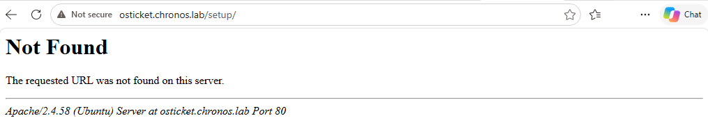

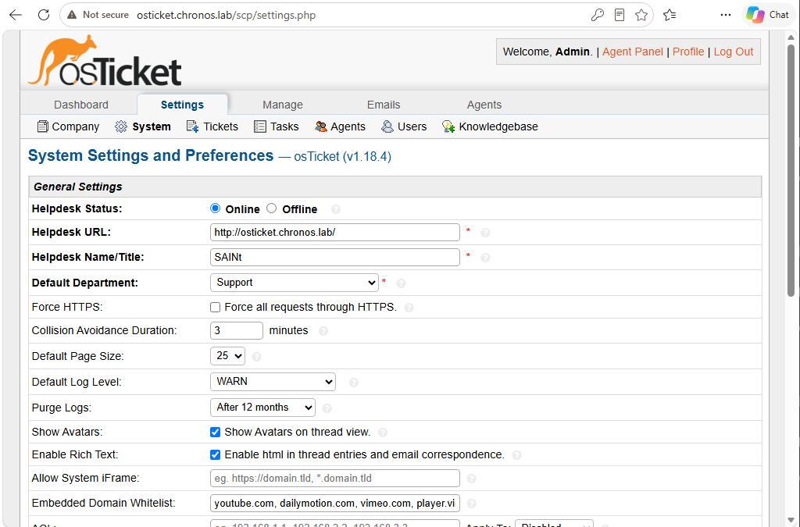

I then set permissions for the configuration file needed by osTicket through:

```bash
sudo chmod 0640 /var/www/osTicket/upload/include/ost-config.php
sudo chgrp www-data /var/www/osTicket/upload/include/ost-config.php
```

These commands removed write access after installation and moved www-data from the others class to the group class on the configuration file. `0640` alone broke osTicket because www-data was in the others class, which got the `0` digit. `chgrp www-data` fixed it because it moved www-data to the group class, giving it the read access it required while following the principle of least privilege.

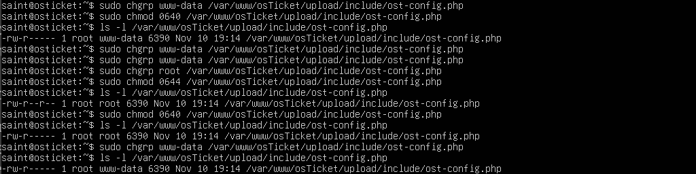

## 5. Host firewall

The final step was to enable only port 22 and port 80 traffic coming from 10.20.0.0/24 network, with a default deny action for all incoming traffic and a default allow for all outgoing traffic, before i enabled the firewall on the ubuntu server VM instance.

```bash
sudo ufw allow from 10.20.0.0/24 to any port 22 proto tcp
sudo ufw allow from 10.20.0.0/24 to any port 80 proto tcp
sudo ufw default deny incoming
sudo ufw default allow outgoing
sudo ufw enable
sudo ufw status verbose
```

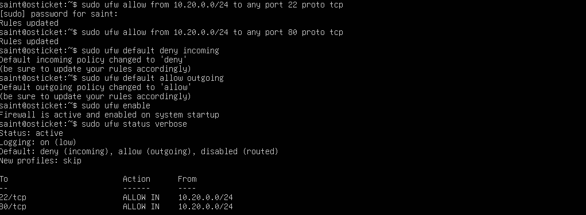

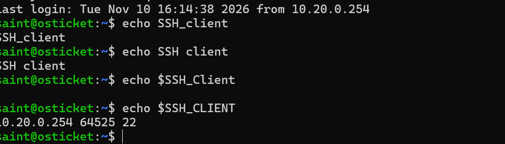

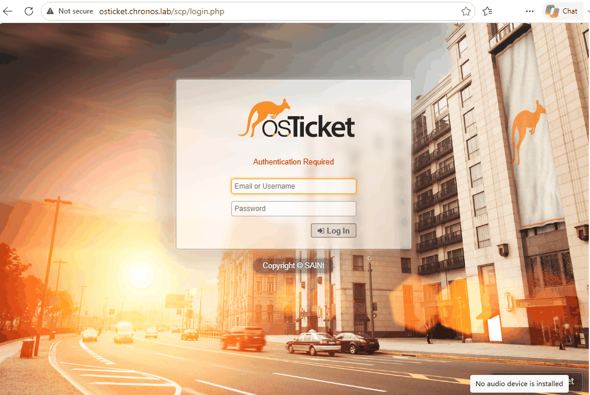
