# RB-009: Entra for people: MFA and Conditional Access

A break-glass account, an Entra ID P2 trial with group-based licensing, and three baseline Conditional Access policies that replace Security Defaults. Prerequisites: [RB-007](RB-007-Connecting_Entra_Connect_to_on-prem_AD.md) (Entra Connect Sync running) and [RB-008](RB-008-Modifying_AD_users_through_scripts_and_pushing_to_Entra.md) (synced test users).

## Break-glass account

Before changing anything that could lock me out, I created a break-glass account: an emergency Global Administrator that is excluded from every Conditional Access policy and is never used for daily work.

- Cloud-only, on the `<tenant>.onmicrosoft.com` domain rather than `chronos.saintshubs.com`. The custom domain is my synced UPN suffix, so a matching AD user could be soft-matched by Entra Connect and take over the account, and a custom domain also depends on DNS and verification.
- Global Administrator as a permanent role assignment.
- A random 32-character password generated in Bitwarden and stored in the vault.

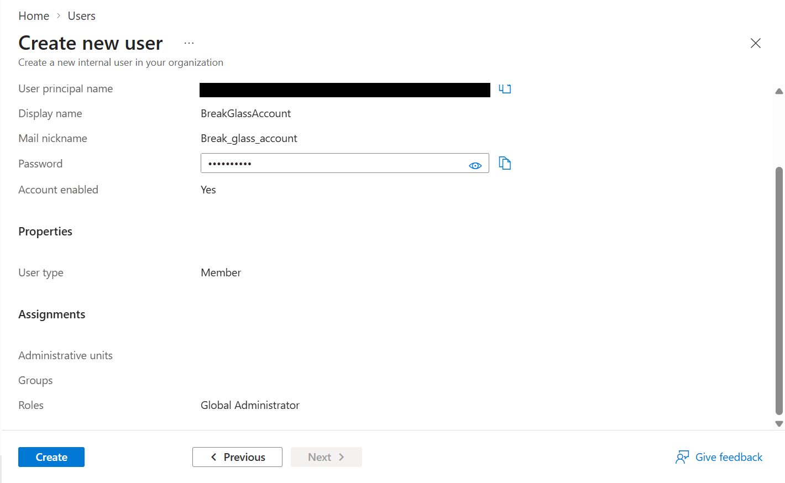

I signed in once in an Incognito window to prove the account works, then signed out.

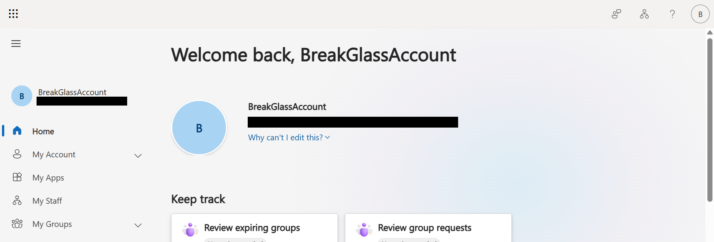

## Policy design

Before starting the trial, I designed three baseline policies on paper. Each one is a single sentence: IF [users] sign in to [apps] under [conditions], THEN [grant or block].

| # | Policy | Users | Apps | Conditions | Grant | Starting state |
|---|---|---|---|---|---|---|
| 1 | Require MFA for all users | All users, excluding break-glass | All resources | None | Require MFA | Report-only |
| 2 | Block legacy authentication | All users, excluding break-glass | All resources | Client apps: Exchange ActiveSync, Other clients | Block access | Report-only |
| 3 | Require MFA for admin roles | Admin directory roles, excluding break-glass | All resources | None | Require MFA | On |

Policy 1 started in report-only because it hits every user and every app, and I had no evidence yet of who would fail. Policy 2 followed the same principle. Policy 3 went straight to On because it replaces what Security Defaults already enforced for admins; leaving it in report-only would have opened an admin gap the moment Security Defaults went off.

## Entra ID P2 trial

My daily admin account is a personal Microsoft account that is a guest in the directory, and the trial signup would have created a brand-new tenant for it. I created a cloud-only account, `admin-billing@<tenant>.onmicrosoft.com`, with the Billing Administrator role (least privilege: buying a trial doesn't need Global Administrator), and started the trial with it.

The order failed with error 43881 ("We need some more information to verify your order"). The organization profile was already complete; the order went through after I switched the payment method from a virtual card to a physical debit card.

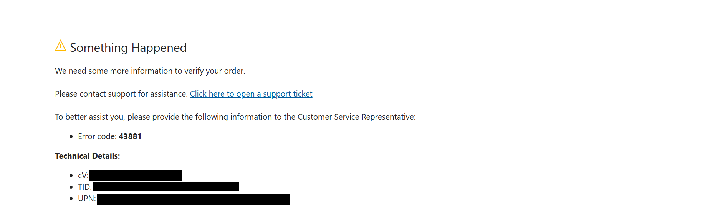

On the first day I turned recurring billing off, so the trial expires on 25 Dec 2026 instead of converting to a paid 1-year subscription.

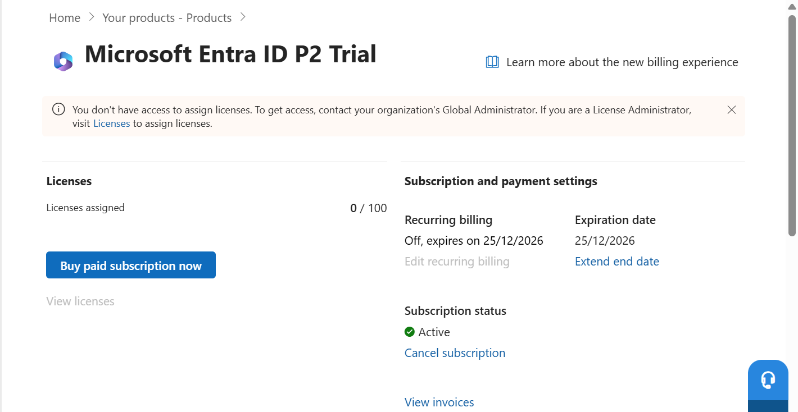

## Group-based licensing

Every user covered by these policies needs a P1 or P2 licence, so I licensed a group rather than individual users. I created a dynamic group, `LIC-EntraP2` (Entra admin center → Groups → New group), so joiners from the joiner script are licensed with no extra step. The first rule, `user.dirSyncEnabled -eq true`, also matched disabled leavers, because `OU=Leavers` is in sync scope:

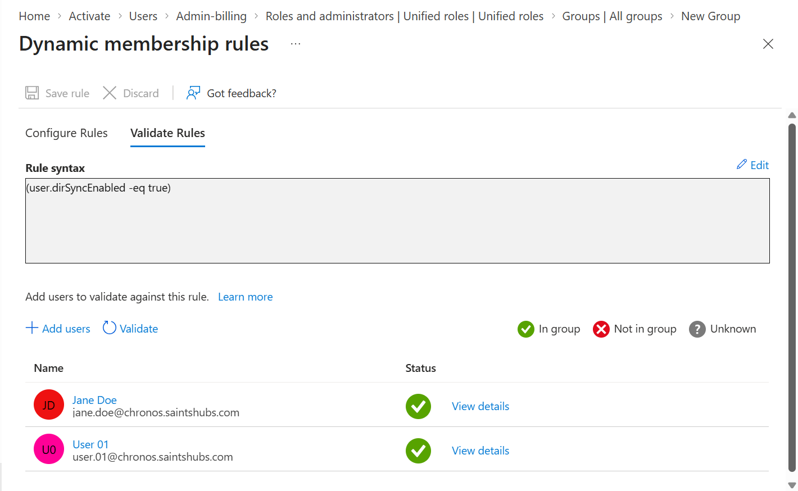

I added an enabled condition, so the final rule is `(user.dirSyncEnabled -eq true) and (user.accountEnabled -eq true)`, and validated it again:

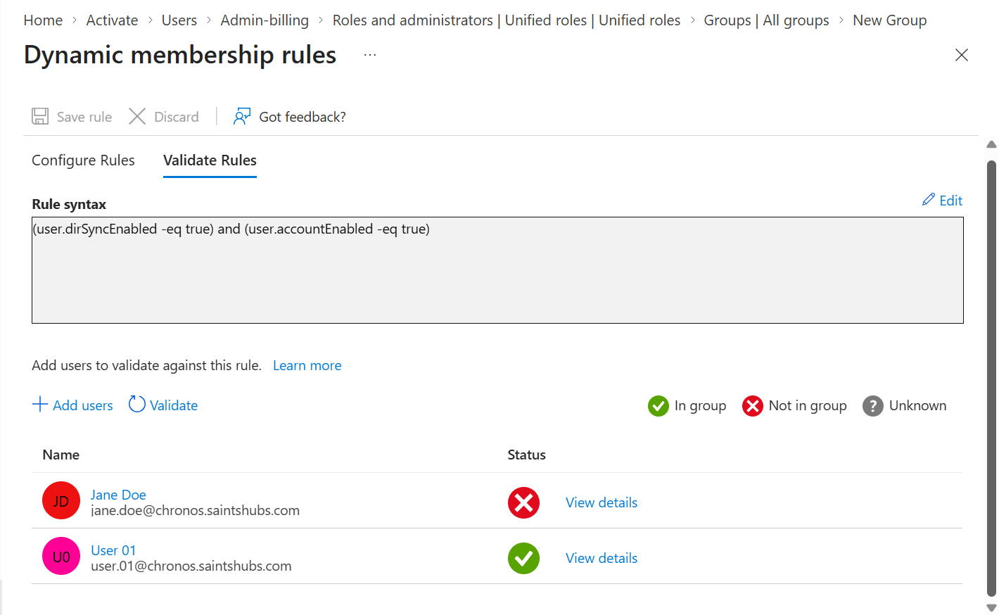

Assigning the licence needed the License Administrator role, so I gave it to admin-billing as a PIM eligible assignment (Entra admin center → Users → admin-billing → Assigned roles → Add assignments) rather than an active one, valid for one day, and activated it only when I needed it.

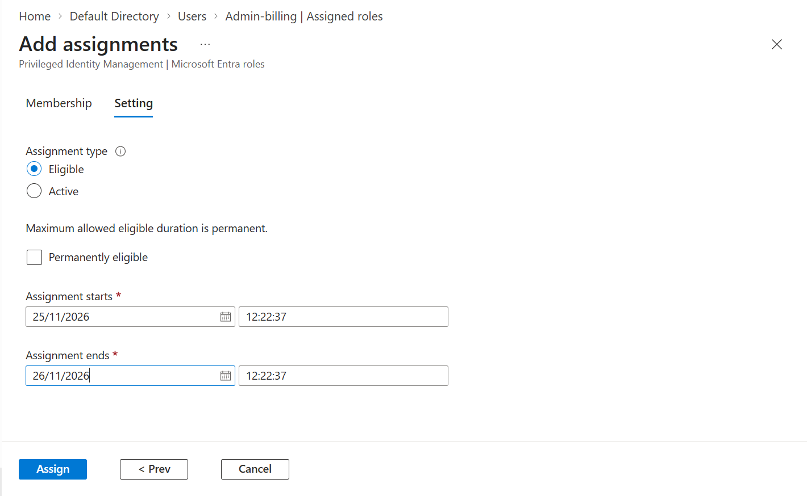

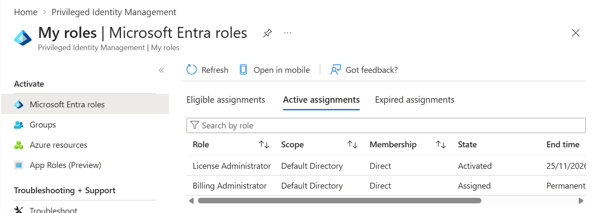

After activating the role, the M365 admin center still showed no Assign button: roles are read at sign-in, so I signed out and back in to get a new token. Then, in M365 admin center → Billing → Licenses → Microsoft Entra ID P2, I assigned the licence to `LIC-EntraP2`.

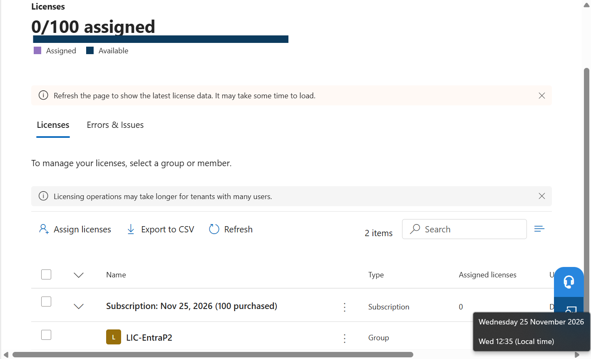

The group holds only the enabled synced users. The two synced users missing from it (Guinea Pig and Mark Test) are disabled, so the rule excludes them correctly.

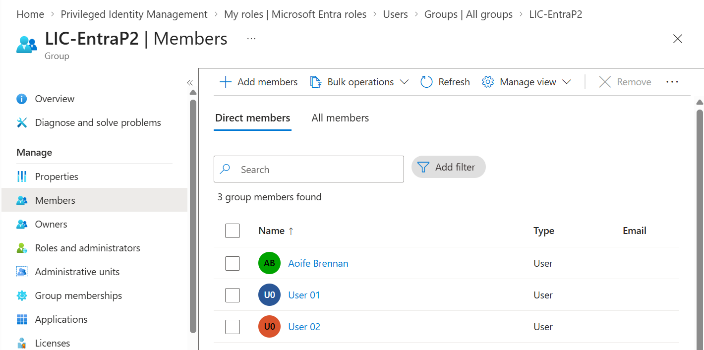

## Conditional Access

Security Defaults and Conditional Access can't both be on, so I disabled Security Defaults (Entra → Overview → Properties → Manage security defaults → Disabled, reason: "My organization is planning to use Conditional Access"), then built policy 3 immediately.

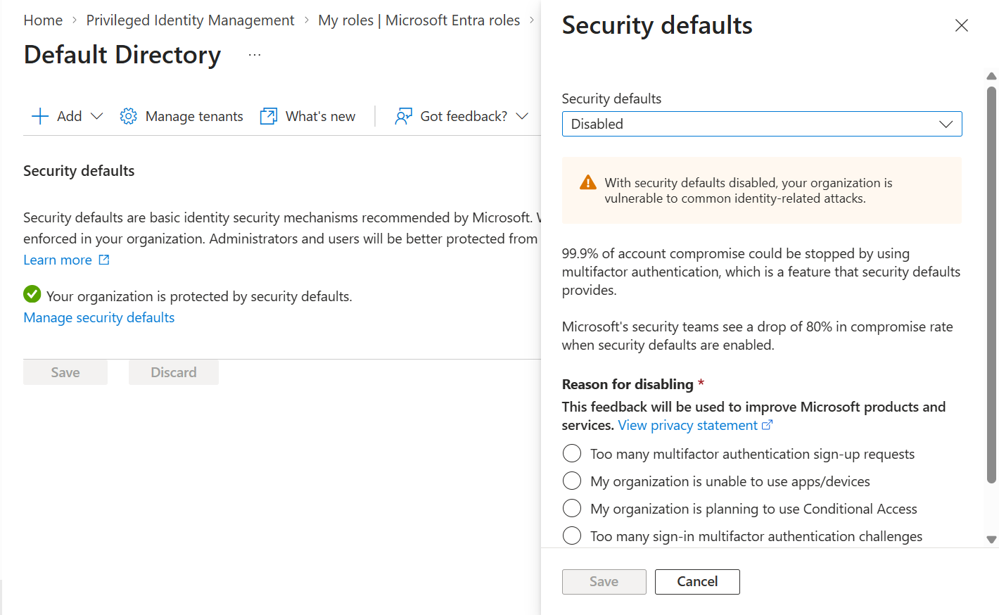

### Policy 3: Require MFA for admin roles

Users: include seven admin directory roles, exclude the break-glass account. Target resources: all resources. Grant: require multifactor authentication. State: On.

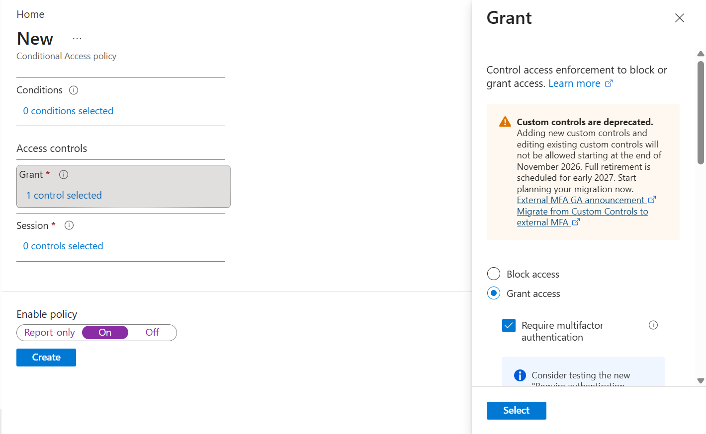

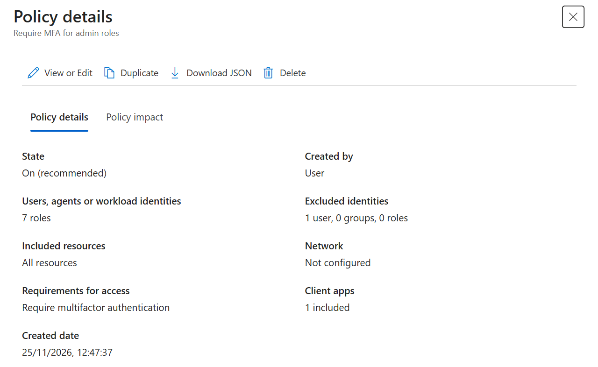

On the "Don't lock yourself out" warning, I chose "Proceed anyway" rather than "Exclude current user". Excluding my own admin account would leave the most-targeted account in the tenant without MFA; the break-glass account is the recovery path.

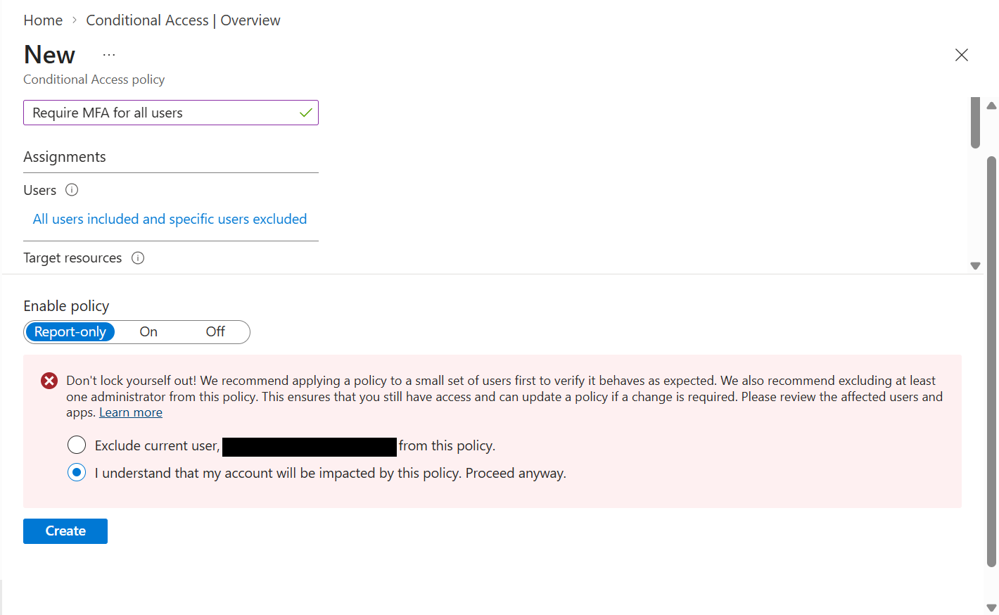

Policy 3 applied to my own admin session straight away. I was made to register Microsoft Authenticator, the first registration attempt timed out, and the old portal session then failed with AADSTS50076 (MFA required, and the token had no MFA claim). Signing in again with MFA fixed it. While I checked from the break-glass account, the Entra admin center also asked that account for MFA: Microsoft enforces MFA on its admin portals for every account, and a Conditional Access exclusion doesn't switch that off.

### Policies 1 and 2 in report-only

Policy 1 (Require MFA for all users): all users excluding break-glass, all resources, no conditions, require MFA, report-only.

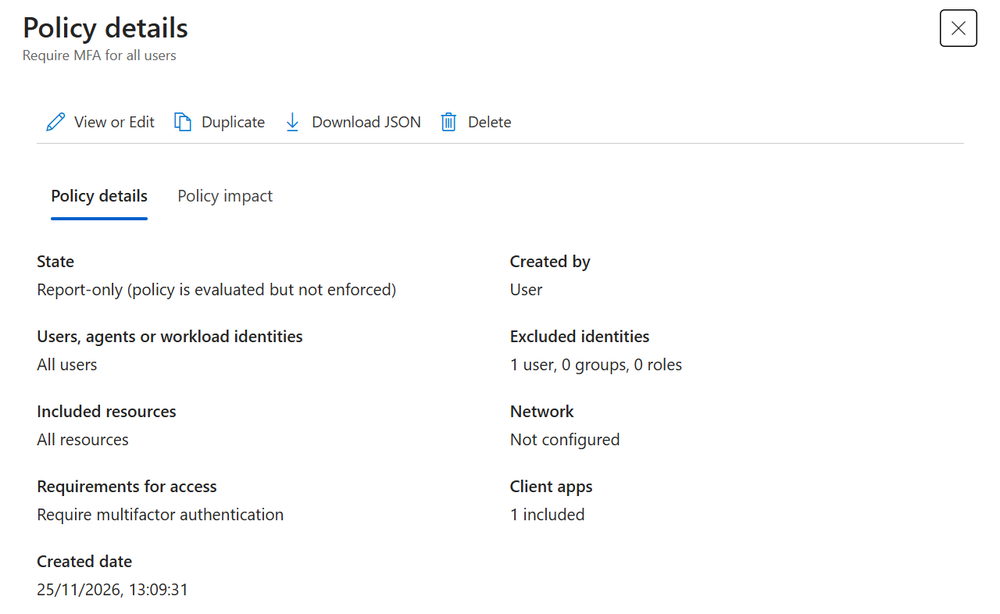

Policy 2 (Block legacy authentication): all users excluding break-glass, all resources, client apps Exchange ActiveSync and Other clients, block access, report-only. My first save of this policy had no users and no resources, so it applied to nobody; I caught it in the policy summary and fixed it.

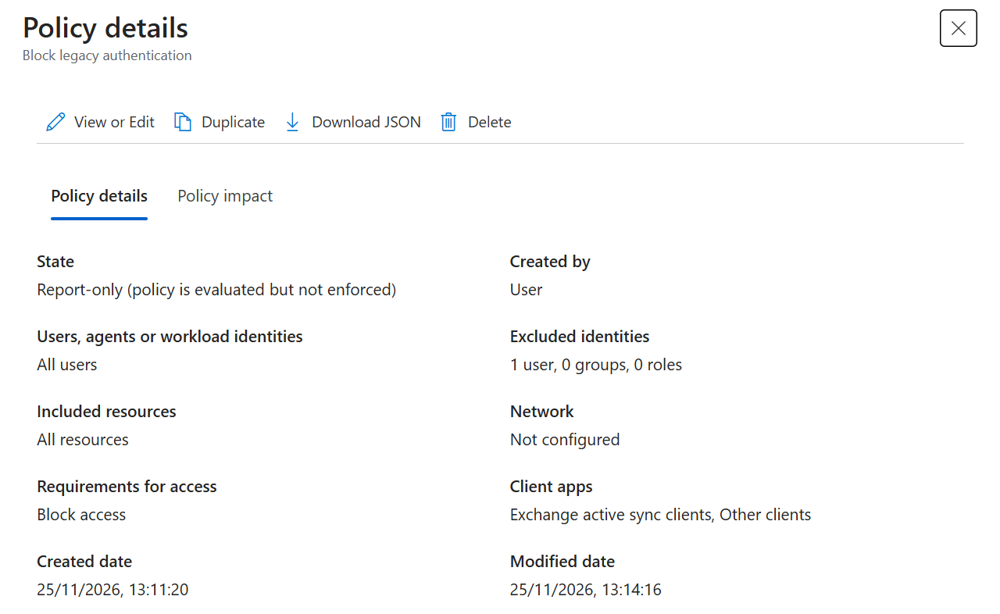

### Checking the report-only results

I signed in as `user.01@chronos.saintshubs.com` in an Incognito window, then opened that sign-in in Entra → Users → User 01 → Sign-in logs → Report-only. The user got in without MFA, as report-only allows, but the log recorded what each policy would have done:

- Require MFA for all users: Report-only: User action required (user.01 had no MFA method, so it would have had to register one).
- Block legacy authentication: Report-only: Not applied (a browser sign-in is modern authentication).

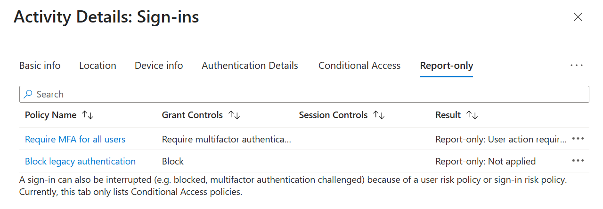

To check for legacy authentication, I filtered the tenant sign-in logs (interactive, last 7 days) on the 13 legacy client app types. There were no legacy sign-ins, so blocking them affects nobody.

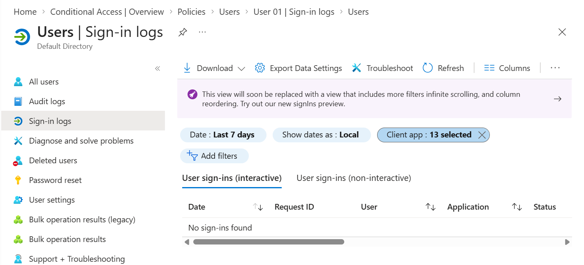

### Turning policies 1 and 2 on

With that evidence, I switched policies 1 and 2 to On.

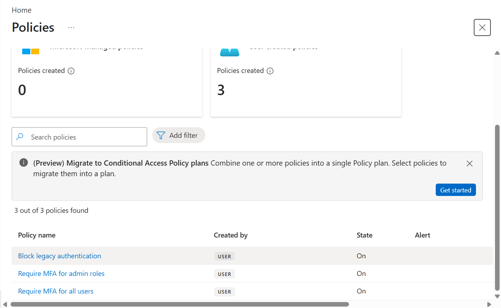

I signed in as user.01 again, and this time the sign-in stopped and made the user register Microsoft Authenticator before continuing.

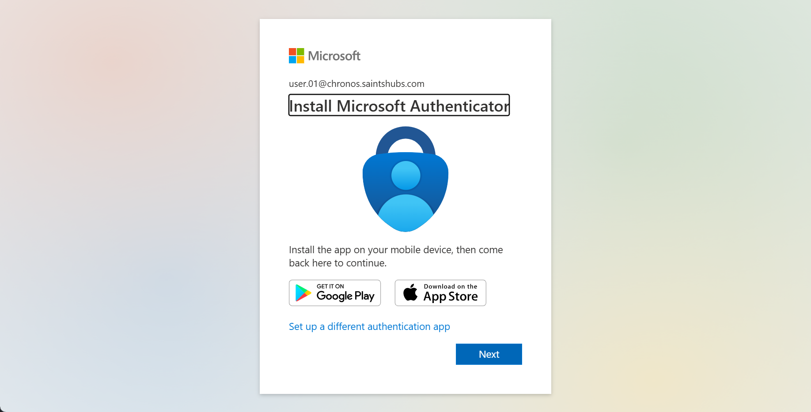

After registration, the sign-in log (Non-interactive tab) showed Authentication requirement: Multifactor authentication, with "MFA requirement satisfied by claim in the token": MFA was done during registration and the token carried it into the follow-up sign-in.

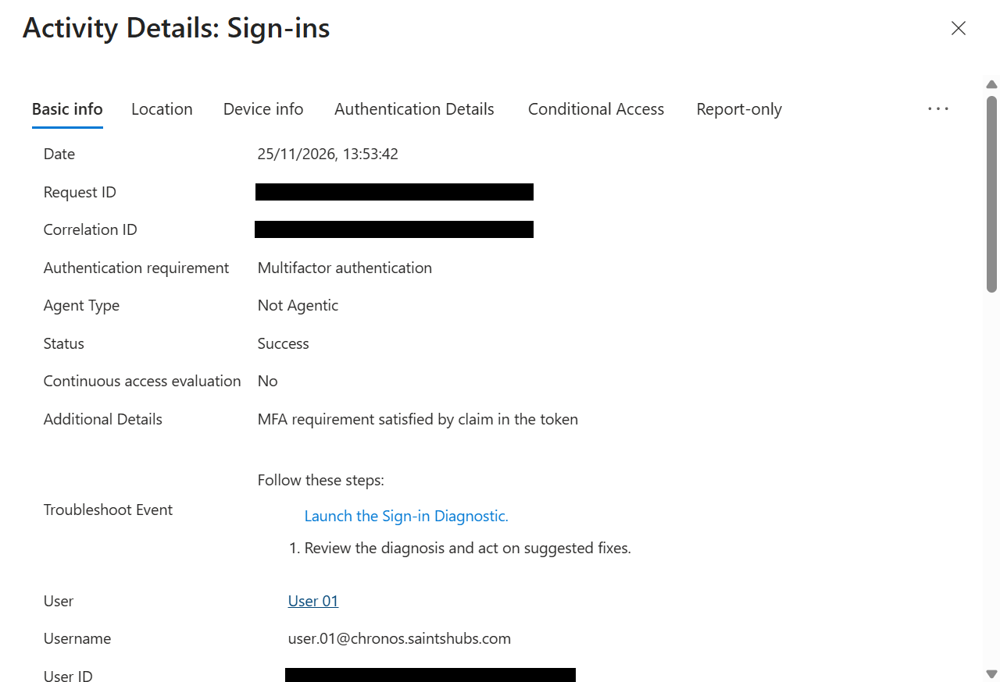

## Known gaps

- The break-glass account's Authenticator is on the same phone as my admin account, which is a single point of failure. It needs its own phishing-resistant method (FIDO2 key or passkey).
- Between turning policy 1 on and a user's next sign-in, whoever signs in first with that user's password registers the MFA method. Temporary Access Passes or a registration policy would close that window.
- Push MFA stops password-only attacks but is still phishable through adversary-in-the-middle proxies.
